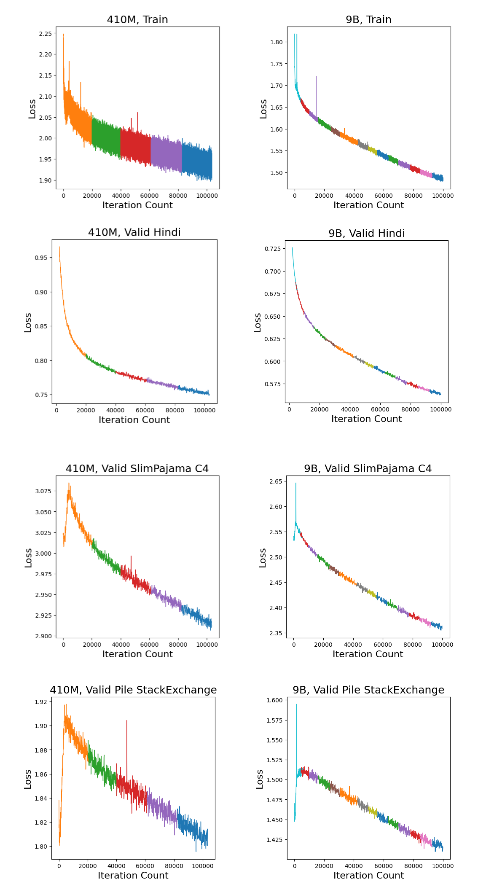
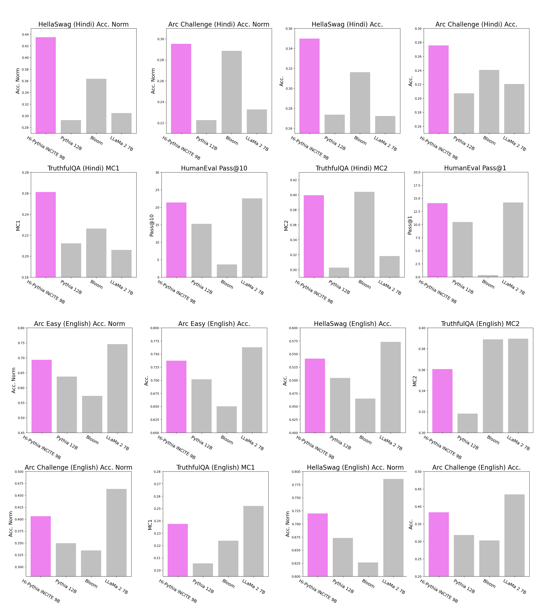
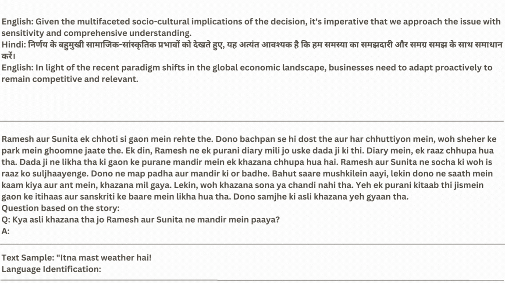

<figure class="banner">
  
</figure>

## Abstract

GPT-4 and similar models perform well, mostly in English, but strong language models for many other languages still need to be built.

We introduce Hi-NOLIN, an open-source English-Hindi bilingual model. We build on the Pythia model suite, first expanding the 7B Pythia architecture to a 9B model, which scales more efficiently on our hardware (6 GPUs per node instead of 8). We trained it on the 300B-token Pile corpus, which contains English and code, and then continued pretraining on a dataset that combines Hindi and English, to extend the model's ability to understand and generate Hindi.

Using established practices for continual training, such as learning rate re-warming and data replay, we transfer the model's capabilities to a new language despite the relatively small amount of Hindi training data, and also improve on the original language and domains (English and code). Our continually trained 9B model outperforms the larger Pythia 12B model while adding Hindi. This contrasts with recent extensions of LLMs such as LLaMa to code (Code LLaMa) and to German (LeoLM), which typically lose performance in the original domains, a problem known as catastrophic forgetting in continual learning.

The results below are for Hi-NOLIN-9B after 600B tokens of training on the new dataset that contains Hindi. The bilingual model also generalizes to Hinglish, the informal code-mixed English and Hindi spoken by over 350 million people.

## Introduction

Hindi is one of the most widely used languages, spoken by more than 600 million people, with a long history and a large body of literature. Yet no open-source, high-quality Hindi LLM had been built, perhaps because of the relative scarcity of data for training such a model from scratch.

To work around this, we continually train our Hindi model on top of open-source LLMs that were pretrained mostly on English. The aim is to extend these models to the new language without forgetting what they learned before, and without the cost of training from scratch on a large mixed dataset of Hindi and the original pretraining data. Earlier work such as Code LLaMa (LLaMa extended to code) and LeoLM (LLaMa extended to German) showed that extending a model to a new domain lowers its performance on the original domain, even with optimizer re-warming. This is the catastrophic forgetting problem in continual learning.

## Results

- **Hindi.** On Hindi HellaSwag, ARC Challenge and TruthfulQA (MC1), Hi-NOLIN scores higher than Pythia 12B, BLOOM and LLaMa-2 7B. On Hindi TruthfulQA (MC2) it is about level with BLOOM.
- **English.** Continued pretraining also improved English: Hi-NOLIN scores higher than the larger Pythia 12B on ARC Easy, ARC Challenge, HellaSwag and TruthfulQA, and narrows the gap to LLaMa-2 7B.
- **Code.** On HumanEval (Python), Hi-NOLIN scores higher than Pythia 12B and close to LLaMa-2 7B.

## Model and training details

Hi-NOLIN's architecture was modified slightly from Pythia to make full use of the unusual 6-GPU nodes of the Summit supercomputer. We used [GPT-NeoX](https://github.com/EleutherAI/gpt-neox), [Megatron-LM](https://github.com/NVIDIA/Megatron-LM) and [DeepSpeed](https://github.com/microsoft/DeepSpeed) to train with 3D parallelism and the ZeRO redundancy optimizer on 3,072 GPUs across 512 nodes. We assume that the optimizer state from pretraining is not available for continual training, as with open models such as LLaMa and Mistral, so we reinitialize it and use the re-warming schedule of [Gupta et al., 2023](https://arxiv.org/abs/2308.04014).

<figure>
  
  <figcaption>Training loss and validation loss (Hindi, SlimPajama C4, Pile StackExchange) for the 410M and 9B models.</figcaption>
</figure>

Unlike the 410M model, the 9B model's training loss and Hindi validation loss decrease steadily with few spikes, and are still decreasing at the last plotted step. Validation loss on English data first rises, then falls well below its starting value.

## Benchmarks

We measure Hi-NOLIN on Hindi, English and code with standard LLM benchmarks: HellaSwag, TruthfulQA, ARC and HumanEval.

<figure>
  
  <figcaption>Hindi, English and code benchmarks. Hi-NOLIN appears as "Hi-Pythia INCITE 9B".</figcaption>
</figure>

## Few-shot examples

<figure>
  
</figure>

<figure>
  
</figure>

## Release

The model is released under the Apache 2.0 license on [Hugging Face](https://huggingface.co/nolanoAI/Hi-NOLIN-9B).

## Acknowledgements

The model was trained on 3,072 GPUs provided through the [INCITE](https://www.alcf.anl.gov/science/incite-allocation-program) compute grant on the [Summit](https://en.wikipedia.org/wiki/Summit_%28supercomputer%29) supercomputer at the [Oak Ridge Leadership Computing Facility (OLCF)](https://www.olcf.ornl.gov/), a DOE Office of Science User Facility supported under Contract DE-AC05-00OR22725. The grant was awarded to the [AAI CERC lab](https://www.irina-lab.ai/) at [Université de Montréal](https://www.umontreal.ca/), [LAION](https://laion.ai/) and [EleutherAI](https://www.eleuther.ai/) for the [Scalable Foundation Models for Transferrable Generalist AI](https://sites.google.com/view/irinarish/incite-project) project. We are grateful for the support of the OLCF leadership and the OLCF liaison for the INCITE project.

We also thank the [INCITE project team](https://sites.google.com/view/irinarish/incite-project), especially Kshitij Gupta and the other contributors to the Continual Pretraining of Foundation Models project; this work builds on their [work on continual pretraining](https://arxiv.org/abs/2308.04014) of Pythia models. Many thanks to Quentin Anthony ([EleutherAI](https://www.eleuther.ai/) and the INCITE project team) for porting DeeperSpeed and the GPT-NeoX training framework to Summit, and for advice on designing the Pythia 9B model to make full use of the training resources.

## References

- Biderman, S., et al. (2023). *Pythia: A Suite for Analyzing Large Language Models Across Training and Scaling.* [arXiv:2304.01373](https://arxiv.org/abs/2304.01373).
- Gupta, K., et al. (2023). *Continual Pre-Training of Large Language Models: How to (re)warm your model?* [arXiv:2308.04014](https://arxiv.org/abs/2308.04014).
- Rozière, B., et al. (2023). *Code Llama: Open Foundation Models for Code.* [arXiv:2308.12950](https://arxiv.org/abs/2308.12950).
- Rajbhandari, S., et al. (2020). *ZeRO: Memory Optimizations Toward Training Trillion Parameter Models.* [arXiv:1910.02054](https://arxiv.org/abs/1910.02054).
- Andonian, A., et al. (2023). *GPT-NeoX: Large Scale Autoregressive Language Modeling in PyTorch* (Version 2.0.0) [Software]. [doi:10.5281/zenodo.5879544](https://doi.org/10.5281/zenodo.5879544).
- Gao, L., et al. *A framework for few-shot language model evaluation* (Version v0.0.1) [Software]. Zenodo. [doi:10.5281/zenodo.5371628](https://doi.org/10.5281/zenodo.5371628).
- BigScience Workshop, et al. (2023). *BLOOM: A 176B-Parameter Open-Access Multilingual Language Model.* [arXiv:2211.05100](https://arxiv.org/abs/2211.05100).
- Touvron, H., et al. (2023). *Llama 2: Open Foundation and Fine-Tuned Chat Models.* [arXiv:2307.09288](https://arxiv.org/abs/2307.09288).
- Plüster, B. *LeoLM: Igniting German-Language LLM Research.* LAION. [laion.ai/blog/leo-lm](https://laion.ai/blog/leo-lm/).
