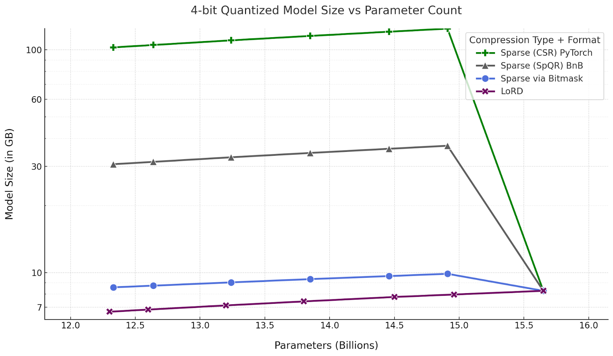
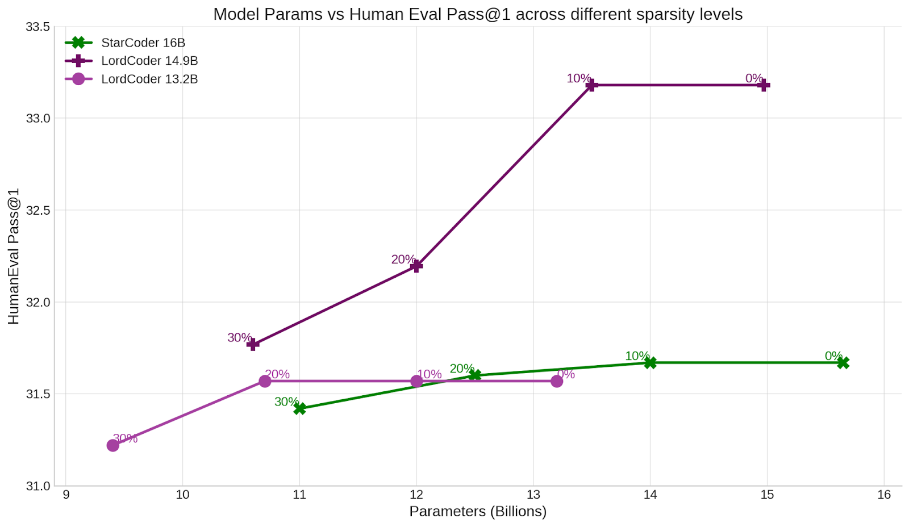

In the months before this post (August 2023), several open-source code LLMs were released in various sizes. Some are competitive with OpenAI's Codex and ChatGPT models, especially after fine-tuning, and there is growing interest in deploying them to power copilots on-premises and on individual devices. But these models have up to 16 billion parameters, need large amounts of memory, and are slow at inference.

We released LoRDCoder models (v0) on Hugging Face: compressed versions of the open-source StarCoder LLM, based on low rank decomposition (LoRD). The design was partly inspired by the effectiveness of low-rank adapters (LoRA), and it has several advantages over pruning and quantization:

- The weights of a LoRD model are dense. Unlike pruning, it parallelizes well on GPUs and has no sparse-format overhead.
- A LoRD model needs no specialized kernels, unlike quantized models, which may even need tailoring for each target hardware. LoRD-compressed models use the floating point matrix multiplication kernels already available at different precisions in open-source libraries such as PyTorch, JAX, TinyGrad and ONNX.
- The compressed network is fully differentiable, so the model stays end-to-end trainable after compression.
- All parameters stay tunable, and the reduced parameter count makes full-parameter fine-tuning cheaper.
- A LoRD model remains LoRA-tunable, and adapters trained for the base model are compatible with it.
- A LoRD model can be compressed further with quantization, pruning and distillation, with returns similar to those for the base model.

LoRD models offer these benefits with little or no drop in performance.

## HumanEval results

We report LoRD-compressed versions of StarCoder 16B, which we call LoRDCoder, at several levels of parameter reduction on the [HumanEval benchmark](https://github.com/openai/human-eval/). Scores are averaged over 5 runs, using [Code-Eval](https://github.com/abacaj/code-eval/).

<div class="tbl" markdown="1" tabindex="0" role="region" aria-label="HumanEval Pass@1 and Pass@10 for code LLMs and LoRDCoder models">

| Model | Pass@1 | Pass@10 |
|---|---|---|
| Replit-Code 3B | 17.13% | 29.88% |
| Stable Code 3B | 20.18% | 33.75% |
| CodeT5+ 16B | 30.90% | 51.60% |
| CodeGen1 Mono 16B | 29.28% | 49.86% |
| CodeGen2 16B | 20.28% | 36.50% |
| MPT 30B | 25.00% | - |
| CodeGen2 16B | 20.90% | - |
| CodeGen2 16B | 20.28% | - |
| StarCoder 16B | 31.67% | 48.29% |
| LoRDCoder v0 14.9B | 33.18% | 48.41% |
| LoRDCoder v0 14.5B | 31.69% | 45.12% |
| LoRDCoder v0 13.8B | 30.90% | 47.56% |
| LoRDCoder v0 13.2B | 31.57% | 45.36% |
| LoRDCoder v0 12.6B | 29.84% | 42.31% |
| LoRDCoder v0 12.3B | 29.22% | 40.12% |

</div>

LoRDCoder can be compressed to 13 billion parameters with no drop in Pass@1, and to 12 billion parameters with a small drop.

## LoRD and quantization

Quantization is a strong compression method that has made it possible to run [LLMs on mobile phones](https://llm.mlc.ai/). It reduces the number of bits per parameter, so larger models fit in RAM and take less time to move between levels of the memory hierarchy.

However, quantization has several shortcomings as a compression method. It needs specialized kernels, often separate for each target hardware. The quantized parameters are not differentiable and cannot be trained with gradient-based optimization. A quantized model is LoRA-tunable, but the LoRA weights cannot be merged into it without additional loss. And it may not reduce the FLOP count or give any speedup at large batch sizes (or when encoding long prompts), [especially during fine-tuning](https://github.com/TimDettmers/bitsandbytes/blob/817bdf632529329bb5ba73260e8bdbe22bb9e9d2/bitsandbytes/autograd/_functions.py#L514-L516), compared with its floating point version.

LoRD avoids these shortcomings. It does not compress as far as quantization does, but it can be combined with quantization to get similar gains. We quantize the LoRDCoder models with the [SpQR method](https://arxiv.org/abs/2306.03078) and report HumanEval Pass@1:

<div class="tbl" markdown="1" tabindex="0" role="region" aria-label="HumanEval Pass@1 of LoRDCoder models at FP16, 8-bit and 4-bit">

| Model | Pass@1, FP16 | Pass@1, 8-bit | Pass@1, 4-bit |
|---|---|---|---|
| LoRDCoder 14.9B | 33.18 | 33.17 | 32.01 |
| LoRDCoder 14.5B | 31.69 | 31.58 | 32.74 |
| LoRDCoder 13.8B | 30.90 | 31.10 | 30.73 |
| LoRDCoder 13.2B | 31.57 | 31.52 | 32.01 |
| LoRDCoder 12.6B | 29.84 | 29.87 | 30.22 |
| LoRDCoder 12.3B | 29.22 | 29.14 | 29.45 |

</div>

The HumanEval score drops very little after 4-bit quantization, and in some cases improves slightly. Such occasional improvements from quantization [have been observed before](https://arxiv.org/abs/2307.14936) for code LLMs.

## LoRD and unstructured pruning

Pruning an LLM turns dense weight matrices into sparse ones by removing parameters (setting them to zero). But pruned models only get faster and smaller at very high sparsity, where the LLM's performance starts to degrade. The degradation is even larger for structured pruning, at sparsity levels as low as 50%.

LoRD can replace unstructured pruning as a method for both parameter reduction and model compression. Dense matrices have wider support than sparse matrices across libraries and hardware, and dense matrix multiplications are faster on GPUs.

**LoRD models are smaller (in GB) than pruned models with the same parameter count.**

Transformer inference at small batch sizes is [bottlenecked by memory bandwidth](https://kipp.ly/transformer-inference-arithmetic/), so a smaller model usually means faster inference.

Sparse matrices carry extra overhead: they store the indices of the nonzero (unpruned) elements as well as their values, and those nonzero elements are the remaining model parameters. So at low sparsity (below 60%), sparse matrices are much larger in GB than dense matrices with the same number of parameters. Only at very high sparsity, where the LLM's performance has collapsed, are sparse matrices smaller than dense ones.

<figure>
  
  <figcaption>Model size (4-bit quantized) against parameter count, for LoRD and for pruned models in three sparse formats.</figcaption>
</figure>

We compare 4-bit quantized model sizes across parameter counts for LoRD-compressed models and for pruned models in three unstructured sparse formats:

- Compared with PyTorch's CSR sparse format, dense LoRD models save up to 96 GB at a similar parameter count. CSR is the most efficient sparse format PyTorch supports. It stores the index of each nonzero element in 64 bits, so with 4-bit quantization each nonzero element takes more than 68 bits. PyTorch does not yet support CSR values below 16-bit precision, so the real bits per parameter would be much higher than this estimate.
- Compared with the sparse kernels from SpQR, which store indices in 16 bits instead of PyTorch's 64, LoRD-compressed models save up to 24.6 GB. These kernels were written for floating point matrices; assuming 4-bit quantization support, they would use more than 20 bits per nonzero value. SpQR's custom sparse inference kernels had not yet been released or merged into bitsandbytes, so these estimates are based on the details in the SpQR paper.
- One of the most efficient formats at low sparsity uses a bitmask (1 bit) to mark which values are nonzero, which can bring the cost down to 5 bits per parameter with 4-bit quantization. However, this format is impractical, because low-level software and hardware routines for it are lacking, and it is hard to parallelize. Even so, the LoRD model is at least 28% more efficient than the bitmask format at the same parameter count.

**LoRD models can also be pruned.**

We sparsify two LoRDCoder models with [an LLM pruning method](https://arxiv.org/abs/2306.11695) and compare them with StarCoder on HumanEval. The LoRDCoder models stay competitive after pruning.

<figure>
  
  <figcaption>HumanEval for pruned LoRDCoder models compared with StarCoder.</figcaption>
</figure>

## Citation

```
@misc{kaushal2023lordlowrankdecomposition,
  title={LORD: Low Rank Decomposition Of Monolingual Code LLMs For One-Shot Compression},
  author={Ayush Kaushal and Tejas Vaidhya and Irina Rish},
  year={2023},
  eprint={2309.14021},
  archivePrefix={arXiv},
  primaryClass={cs.CL},
  url={https://arxiv.org/abs/2309.14021}
}
```
