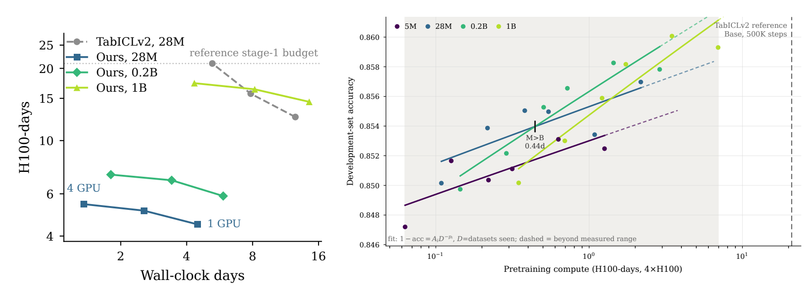
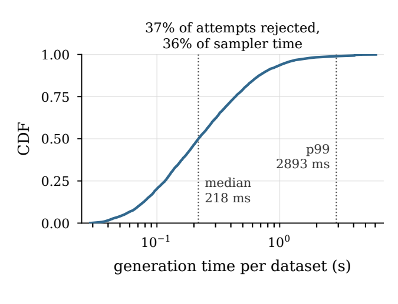
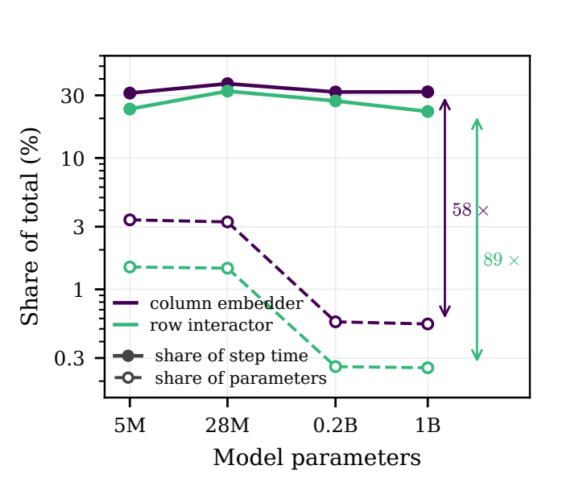
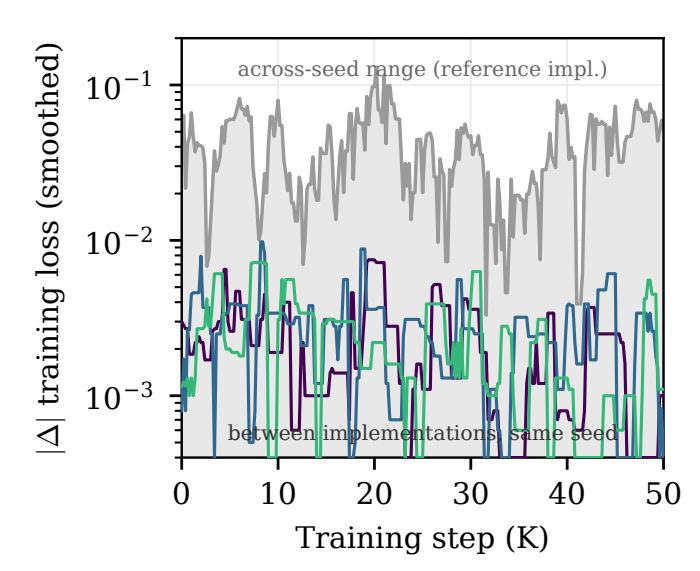
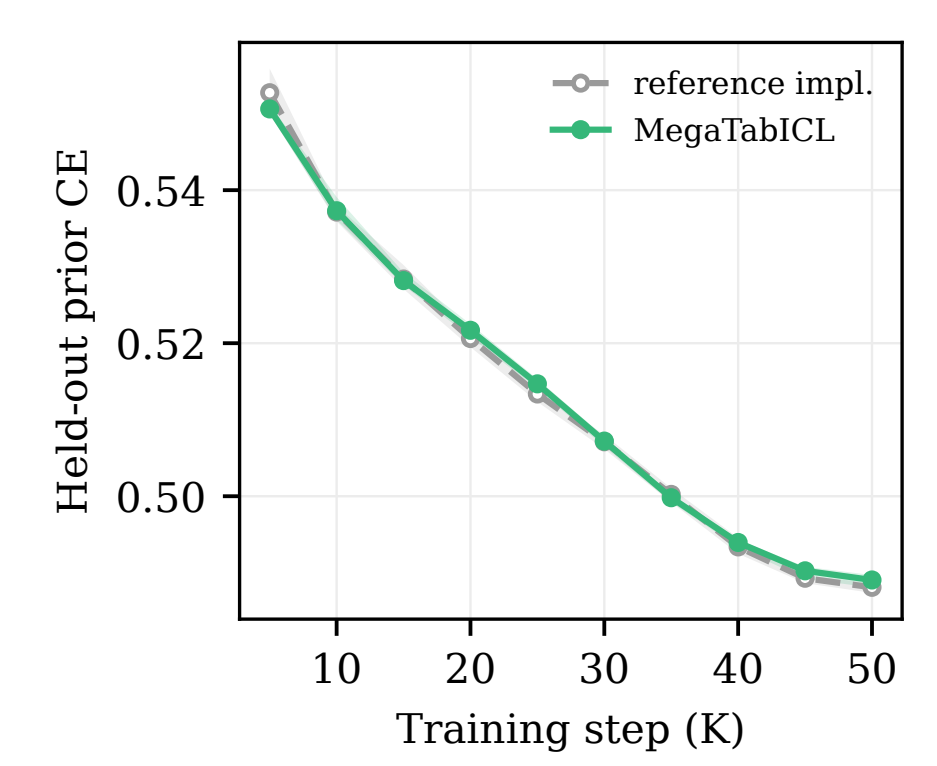
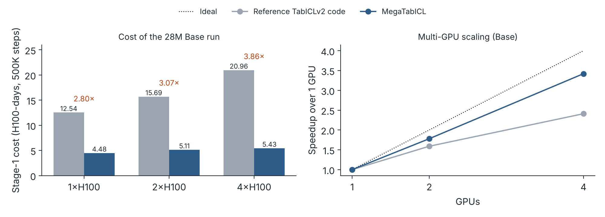
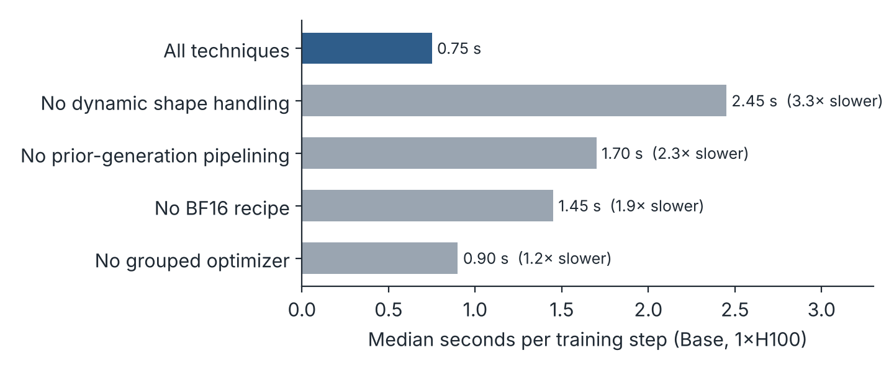
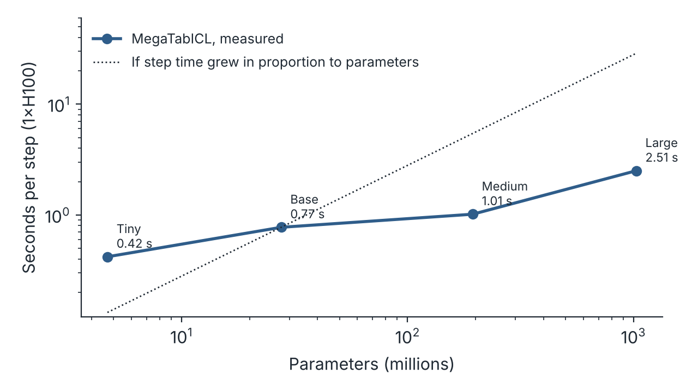
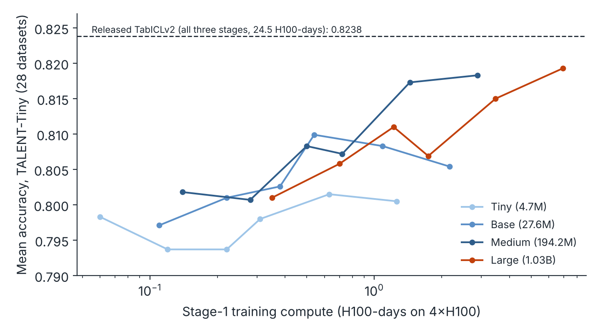

**Ayush Kaushal, Daria Yasafova, Irina Rish** · NeurIPS 2026 Workshop AXIOM: Foundations of Efficient Deep Learning (poster)
[Paper](https://openreview.net/forum?id=WfamdVi3VV) · TODO(owner): public code URL, then restore: [Code](URL) · [BibTeX](#citation)

## Summary

This paper makes four contributions:

1. **A characterization of the workload.** Pretraining a 28M-parameter TabICLv2, a frontier tabular foundation model with an open recipe, costs 24.5 H100-days. We show that most of this cost comes from training practices inherited from other modalities, not from the recipe itself. The tabular pretraining workload breaks three of their assumptions: data generation is heavy-tailed, input shapes change every step, and compute concentrates in low-parameter layers.
2. **MegaTabICL, a pretraining framework built for this workload.** It addresses each of the three properties and matches the reference training trajectory within seed-to-seed variation. It cuts the cost of stage 1, which is over 80% of pretraining, by 3.86× on 4×H100, and trains a 1B-parameter model in less compute than the original 28M run needed.
3. **A stabilized BF16 recipe.** Training TabICLv2 in BF16 is unstable, and model quality does not recover. We traced the cause to its scalable-softmax layer and fixed it by changing that layer's precision and optimizer. The recipe accounts for a 1.9× speedup on its own.
4. **A compute-optimal scaling study.** We trained 24 models from 5M to 1B parameters at six compute budgets. To our knowledge, this is the first billion-parameter scaling study of a state-of-the-art tabular prior. The compute-optimal model size grows with budget; extrapolated to TabICLv2's own stage-1 budget, the fits put it at 0.2B parameters, 7× the size TabICLv2 trains.


*From the paper. Left: stage-1 cost in H100-days against wall-clock days on 1, 2 and 4 H100s, for the reference TabICLv2 code and MegaTabICL at three model sizes. Right: real-world development-set accuracy against pretraining compute for each model size, with fitted power laws (dashed beyond the measured range).*

## Why tabular pretraining is expensive

Tabular foundation models (TFMs) treat prediction on a table as in-context learning. The training rows and their labels form the context, and the model predicts labels for the test rows in a single forward pass, with no gradient updates. To learn to do this, the model is pretrained on millions of synthetic tables drawn from a prior: a random data-generating process, typically built from structural causal models. Pretraining on a prior is a form of meta-training, and the resulting models now match or beat gradient-boosted trees and AutoML pipelines on standard benchmarks.

That makes the cost of pretraining a research bottleneck. TabICLv2 is, to our knowledge, the only frontier TFM with a fully open pretraining recipe, and recent releases cite and build on it. One 28M-parameter run of it takes 24.5 H100-days, about 20 of them in stage 1. At that price, systematic studies of architecture, priors and scaling are out of reach for most groups.

Language modelling met the same barrier with two kinds of infrastructure:

- **Frameworks** that make frontier-scale training tractable, such as Megatron-LM, GPT-NeoX and OLMo.
- **Faithful reimplementations** that recover a baseline at a fraction of the compute, such as Cramming and modded-nanogpt.

TFMs so far have only the second kind, at nano scale or as speedruns on fixed, cached priors. MegaTabICL supplies the first: a framework designed around the TFM pretraining workload.

## Three properties of the workload

The cost of TFM pretraining comes largely from assumptions that hold for language modelling but not here. We characterize the workload through three properties. For each, we identify the assumption it breaks and a remedy that does not change what the model learns.

### 1. Data generation is CPU-bound and heavy-tailed

Tables are generated on the fly from the prior on CPU cores. Their cost depends on the sampled causal graph's complexity, the function types, other hyperparameters, and whether a table is rejected by quality filters and regenerated.


*From the paper. Cumulative distribution of the wall-clock time to generate one table.*

The median table takes 218 ms, but the 99th percentile takes 2,893 ms, 13× longer. Rejected attempts alone consume 36% of sampler time. Language-model training assumes data arrives cheaply, prefetched from disk. Here, every micro-batch waits for its slowest table.

**Remedies:**

- **Cross-batch pipelining.** Several batches are kept in generation at once, so workers that finish early start on the next batch. The order of tables consumed stays bit-identical to sequential generation.
- **One persistent worker pool.** The reference code forks a fresh worker pool for every batch, and the measured wait for data grew from 0.1 s to 13 s over the first 1,000 steps. MegaTabICL creates one pool before CUDA initialization and reuses it, with single-threaded, core-pinned workers.
- **For CPU-poor GPU nodes:** an external generation server on separate CPU nodes. For smaller studies, a compressed table cache: a float32 dump of the stage-1 table stream would take about 6.4 TB, and our typed, zstd-compressed format is 4.6× smaller, losslessly for the values training consumes.

### 2. Input shapes change at every step

TFM recipes avoid padding, so each forward and backward pass sees a different number of rows and columns, spanning orders of magnitude. GPU software amortizes costly one-time compilation across iterations of a fixed shape, so changing shapes break it at several levels.

**Remedies:**

- **Compilation.** We rewrote the shape-dependent parts of the computation graph so that the attention blocks compile once with dynamic shapes. This gives a 1.5× to 1.8× speedup over uncompiled execution, with about 25% lower peak memory, after a one-time compilation of about 40 s. Two recompilation triggers had to go:
  - a length-dependent term computed with Python scalars, replaced by an equivalent bit-exact tensor operation;
  - masking of padded columns, replaced by computing all columns and overwriting the padded outputs, at under 1% extra compute.
- **Attention kernels.** cuDNN's attention backend plans a kernel per input shape, so it re-plans almost every micro-batch. Switching to shape-agnostic kernels cut CPU-side attention time from 2,064 ms to 31 ms per six steps.
- **Load balancing across GPUs.** With contiguous slicing, the slowest of 4 GPUs received 1.314× the mean number of columns, and every synchronization waited for it. A linear cost model fitted to measured micro-batch times, t = 42.7 + 0.791·m ms for m columns, lets us assign micro-batches to GPUs with a greedy longest-processing-time heuristic. This reduces the effective overshoot from 1.150× to 1.015× and needs no extra communication.

### 3. Compute does not follow parameters

Modern TFM architectures first model the table cell by cell. A column embedder attends within each column, and a row interactor within each row. Each row is then compressed to one vector, and an in-context-learning transformer attends across rows.

The cell-level layers have few parameters, but their cost scales with parameters × rows × columns. The in-context-learning transformer holds most of the parameters, but its cost scales only with parameters × rows.


*From the paper. Share of step time (solid) and of parameters (dashed) for the column embedder and row interactor, by model size.*

At every model size, the two cell-level components hold under 5% of the parameters but take over half of the step time. This has two further consequences:

- **No fused attention kernels.** Their attention head dimension of 16 is below the minimum of 64 that FlashAttention-class fused kernels support. Fused kernels can serve only the in-context-learning transformer, about 17% of the step.
- **A dispatch-bound optimizer.** Parameters are fragmented into many small tensors: at 28M parameters, 78% of tensors hold 2.5% of the parameters. A per-tensor optimizer loop is therefore bound by kernel launches. Grouping the optimizer update by tensor shape, which we verified to be bit-exact, cut the optimizer step from 158.9 ms to 14.2 ms.

## A stabilized BF16 recipe

TabICLv2 trains in TF32. Switching all layers to BF16 made training unstable, and it did not recover. We traced the instability to QASSMax, the query-aware scalable softmax that TabICLv2 uses to keep attention from flattening over long contexts. QASSMax's learned multiplier grows during training. In BF16, gradient clipping prevents the run from diverging to NaNs, but model quality degrades and does not recover.

Our recipe changes two things:

- **Precision:** QASSMax is computed in FP32, and every other layer runs under BF16 autocast.
- **Optimizer:** QASSMax's parameters are trained with AdamW instead of Muon.

With these changes, BF16 training follows the reference trajectory (next section), and the recipe contributes a 1.9× speedup on its own. These are the only changes to TabICLv2's numerics. Every other technique in MegaTabICL is either bit-exact or exact up to floating-point reassociation.

## Validating against the reference

A cheaper pretraining run is only useful if it trains the same model. "Bit-exact" means a change was validated to produce identical numbers. "Exact up to floating-point reassociation" means numbers differ only through kernel fusion, kernel selection or summation order. Because the BF16 recipe does change the numerics, we validated the end result against the reference code in three ways:

- **Training loss.** On three matched seeds consuming identical tables for 50K steps, the training-loss gap between MegaTabICL and the reference averages 0.0025. Across seeds within the reference implementation, the gap averages 0.041.
- **Held-out loss.** On held-out tables from the prior, the gap between implementations stays within the seed-to-seed band, at most 0.005 in cross-entropy.
- **The full recipe.** A full 500K-step stage-1 run, continued through TabICLv2's remaining stages, lands within 0.003 mean accuracy of the released TabICLv2 model on the TALENT benchmark.


*From the paper. Absolute training-loss difference between implementations at the same seed (colored), against the range across seeds of the reference implementation (gray).*


*From the paper. Held-out prior cross-entropy at the Base size over three matched seeds: mean per implementation, with min-max band across seeds.*

## How much cheaper


*Stage-1 cost of the 28M Base model (500K steps) and speedup from 1 to 4 GPUs. Redrawn from Table 4 of the paper.*

We measured the reference code at 20.96 H100-days for stage 1 on 4×H100, matching the roughly 20 that the TabICLv2 authors report. At matched hardware, MegaTabICL reduces stage-1 cost by 2.80× on 1 GPU, 3.07× on 2 and 3.86× on 4. The advantage grows with GPU count because scaling efficiency on 4 GPUs rises from 0.60 to 0.85. On a single GPU, peak memory also halves, from 19.3 GiB to 9.8 GiB.


*Step time when one technique is removed at a time, Base model on one H100. Redrawn from Table 1 of the paper.*

Removing any single technique makes training slower. Shape handling and data-generation pipelining matter most, followed by the BF16 recipe and the grouped optimizer. On 4 GPUs, load balancing and a sharded Muon optimizer add a further 1.1×. Sharding Muon matters more at larger sizes: its orthogonalization step otherwise costs 259 ms per step on every GPU at 1B parameters.

These savings carry to larger models. A 1B-parameter model, 37× the size of TabICLv2's Base, completes the full 500K-step stage 1 in 17.35 H100-days (4.34 days on 4×H100), less than the 20.96 the reference code needs for 28M parameters.

## A billion-parameter compute-optimal scaling study

Language modelling has scaling laws that say how to split a compute budget between model size and training data. For tabular foundation models, the largest previous studies trained up to 78M parameters on real data and up to 17M parameters on a closed prior. We used MegaTabICL to go more than an order of magnitude further.

**Setup:**

- **Models:** four sizes, Tiny (4.7M), Base (27.6M), Medium (194.2M) and Large (1.03B), scaling the column embedder, row interactor and in-context-learning transformer together.
- **Budgets:** six, from 0.64M to 12.8M tables (10K to 200K steps at batch size 64), for 24 runs in total.
- **Data:** all 24 runs consume the same table sequence from TabICLv2's prior, without repetition.
- **Training from scratch:** TabICLv2 anneals its learning rate, so each budget is a separate run from scratch, evaluated at its final checkpoint. This avoids the bias of fitting to intermediate checkpoints of one long run.
- **Evaluation:** TabICLv2's real-world development datasets, and held-out tables from the prior.

The whole grid cost 27.5 H100-days, about the price of a single reference TabICLv2 run. Two things made that possible: MegaTabICL's efficiency, and the fact that cost grows much more slowly than model size.


*Mean seconds per training step on one H100 for the four model sizes. Redrawn from Table 4 of the paper.*

Medium is 7.0× the size of Base at 1.31× the step time, and Large is 37× the size at 3.24×.

**Results.** We fit a power law per model size to accuracy (as error, 1 − accuracy) and to held-out loss as functions of tables seen, and compare sizes at equal compute:

- **Crossovers on real-world accuracy and held-out loss.** Medium overtakes Base at 0.44 H100-days on real-world accuracy. Base overtakes Tiny at 0.07 H100-days on held-out loss.
- **Large versus Medium.** Large does not overtake Medium anywhere in the measured range. Its crossing point extrapolates beyond TabICLv2's stage-1 budget on both metrics.
- **The compute-optimal size grows with budget.** Extrapolated to TabICLv2's own stage-1 budget, about 20 H100-days and well beyond our largest run of 6.94, the fits place the compute-optimal size at 0.2B parameters, 7× what TabICLv2 trains.


*Mean accuracy on the 28 classification datasets of TALENT-Tiny for all 24 runs, against stage-1 compute. The dashed line is the released TabICLv2, which was trained through all three stages. Redrawn from Table 6 of the paper.*

On the classification datasets of TALENT-Tiny, Large trained for 200K steps is the strongest run in the sweep (0.8193 accuracy, 0.8966 AUC). Compute-optimality tells a different story: Medium at 200K steps (2.88 H100-days) beats Large at 100K steps (3.47 H100-days) on accuracy, AUC and F1. The released TabICLv2, trained far longer and through two further stages, remains stronger overall at 0.8238. The gap narrows from 0.030 for Tiny at 20K steps to 0.0045 for Large at 200K.

## Differences between TabICLv2's paper and its released code

Matching the reference training trajectory meant following TabICLv2's released code. In doing so, we found that the code differs from the paper in several places:

- The cautious weight decay described in the paper is not applied in the release. The code uses standard weight decay with a coefficient of 0.1, against 0.01 in the paper.
- Muon is applied to every parameter, not only to 2D weight matrices.
- Tensor cores run in TF32 under automatic mixed precision.
- The prior's class-count distribution forces half of all datasets to be binary.

We follow the code. These details matter to anyone trying to reproduce or extend TabICLv2.

## Limitations

- We accelerate stage 1 only, although several techniques transfer to the later stages.
- The scaling study uses one seed per configuration and classification only.
- Compute is measured in H100-days on our implementation, not in FLOPs, so the compute-optimal sizes are tied to our efficiency profile.
- The 0.2B optimum is an extrapolation beyond the measured budgets.

Next steps are extending MegaTabICL to the later stages, adding seeds and covering regression.

## Citation

```bibtex
@inproceedings{kaushal2026megatabicl,
    title = {MegaTabICL: Efficient Scaling of Tabular Foundation Model Pretraining},
    author = {Kaushal, Ayush and Yasafova, Daria and Rish, Irina},
    booktitle = {NeurIPS 2026 Workshop on Foundations of Efficient Deep Learning (AXIOM)},
    year = {2026},
    url = {https://openreview.net/forum?id=WfamdVi3VV}
}
```
