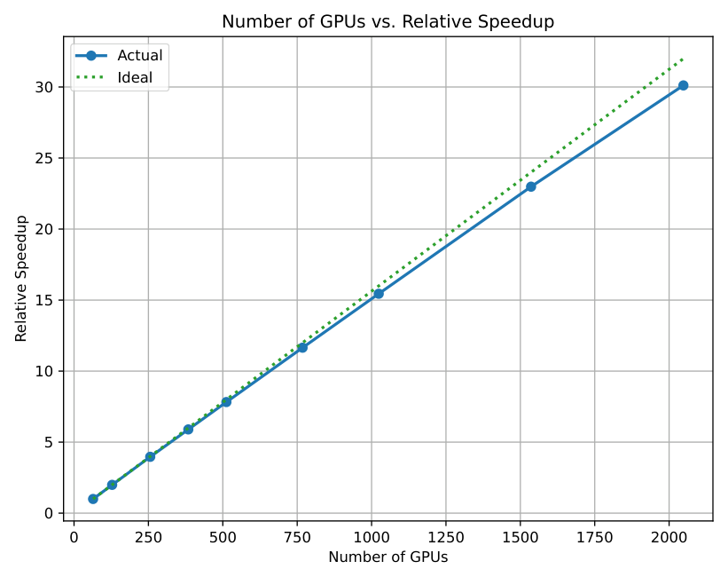
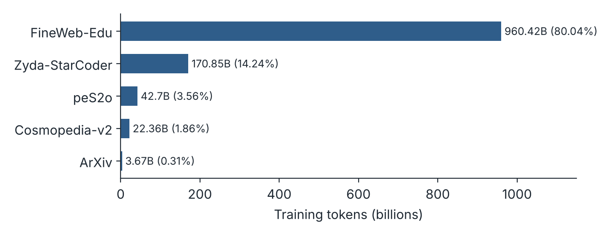
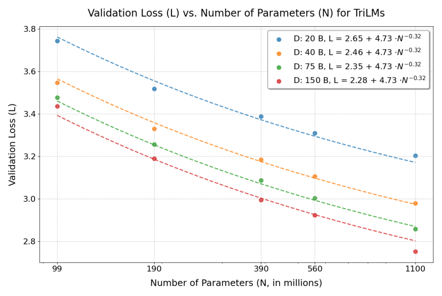
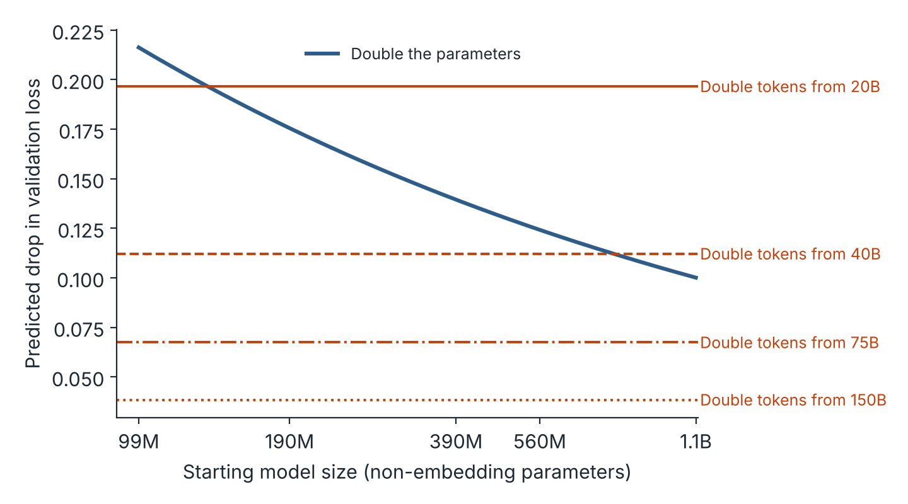
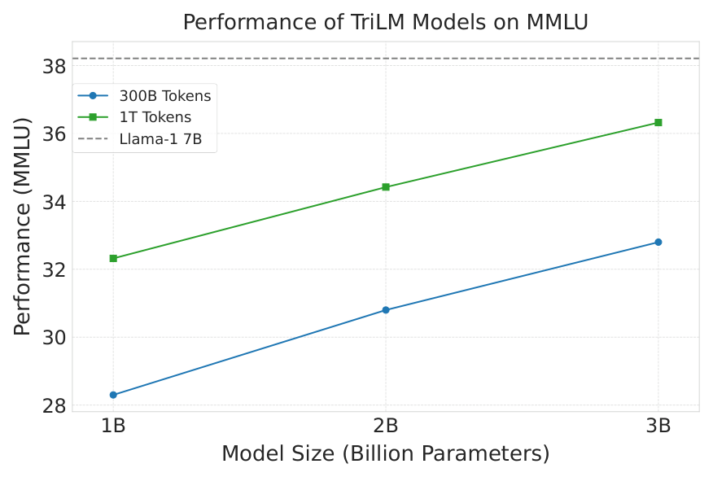
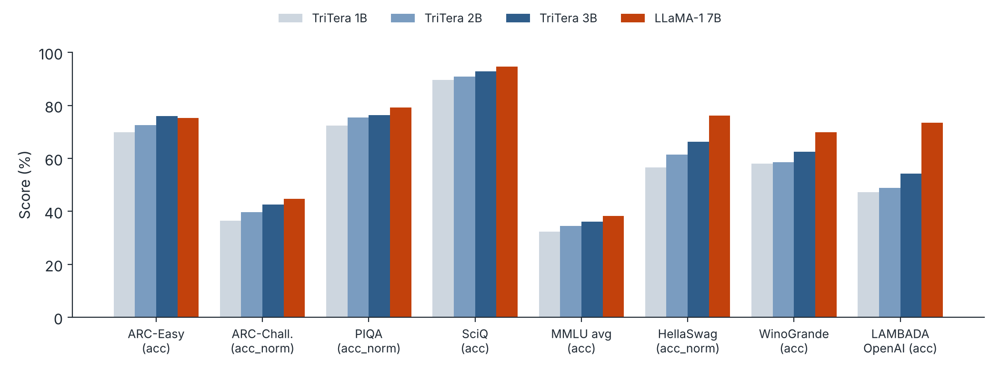
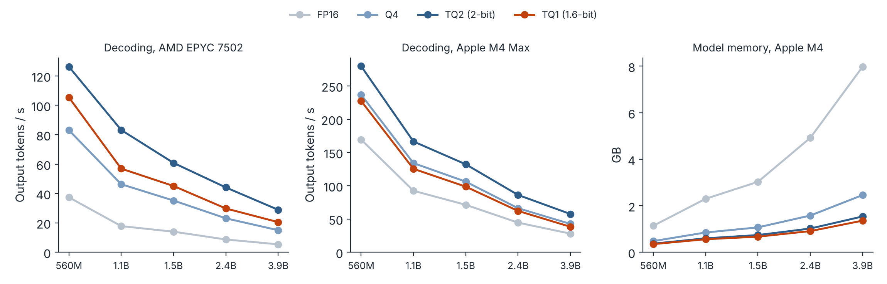
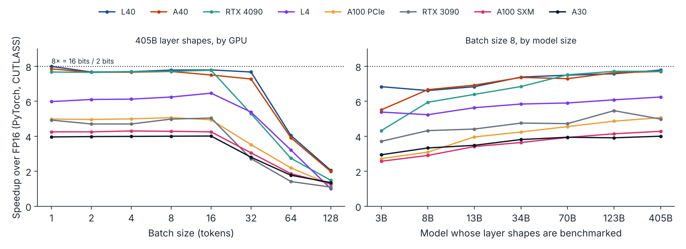
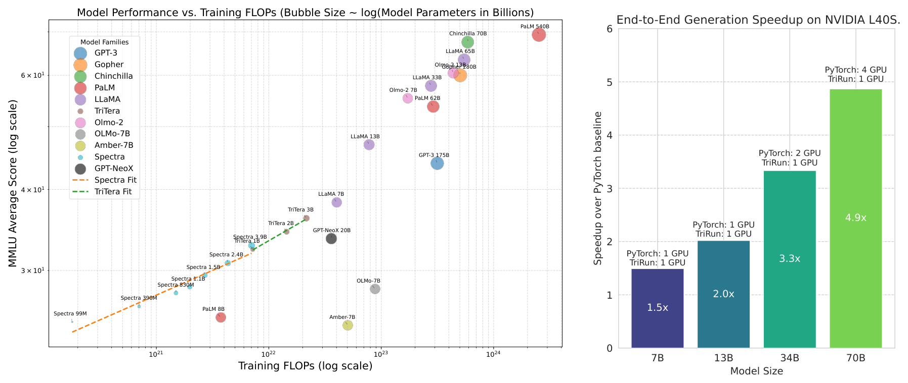
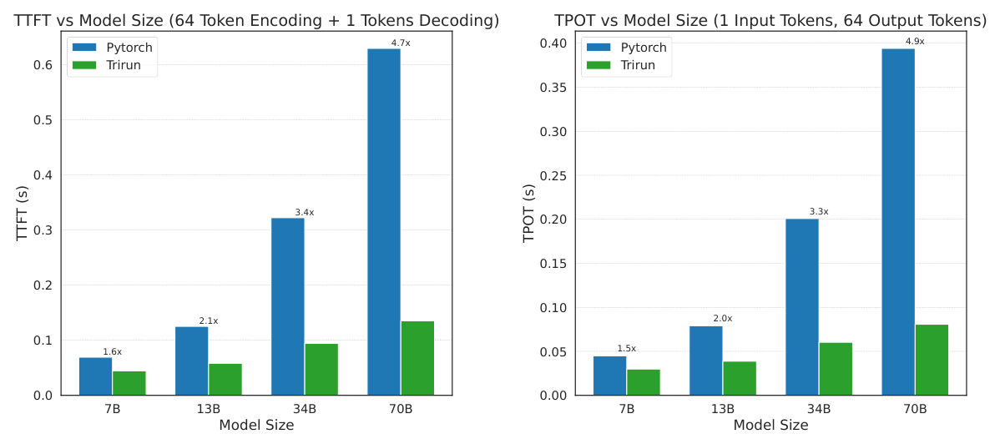

ACL 2025 (Long Papers)
[Paper](https://aclanthology.org/2025.acl-long.1294/) · [arXiv](https://arxiv.org/abs/2506.23025) · [llama.cpp TQ1_0 / TQ2_0](https://github.com/ggml-org/llama.cpp/pull/8151) · [BibTeX](#citation)

*The arXiv version is titled "Spectra 1.1" and calls the model suite Spectra-1.1; the ACL version calls it TriTera. An earlier version appeared at the ICLR 2025 Workshop on Sparsity in LLMs.*

## Summary

- **Scaling law.** We fit a scaling law for ternary language models (TriLMs), whose linear-layer weights take values in {−1, 0, 1} times one scale per matrix. The fit uses five model sizes (99M to 1.1B parameters) and four token budgets (20B to 150B). The data term decays much faster than the parameter term (exponent 0.81 against 0.32). For 16-bit models trained the same way, the two exponents are nearly equal.
- **TriTera.** We trained 1.5B, 2.5B and 3.6B TriLMs on 1.2T tokens. The largest is within about 2 points of LLaMA-1 7B on MMLU (36.12 against 38.21) and ARC, and trails it on HellaSwag, WinoGrande and LAMBADA.
- **Packing.** We give two lossless packings for ternary weights: 2 bits per weight with plain shifts, and 1.6 bits per weight (five weights per byte), within 1% of the 1.585-bit entropy limit. Both run in llama.cpp as TQ2 and TQ1. TQ2 gave the highest decoding throughput on both CPUs we tested.
- **TriRun.** Our FP16 × INT2 GPU kernel approaches the 8× speedup that 2-bit weights allow in the memory-bound regime, up to batch size 16 on L40-class GPUs. End to end, a 70B-parameter configuration on one L40S runs 4.9× faster than FP16 PyTorch on four.

## Why ternary weights

GPU compute has grown faster than memory capacity and bandwidth. Autoregressive decoding reads every weight for every generated token, so it is limited by how many bytes of weights the hardware can move, not by arithmetic. Fewer bits per weight translate almost directly into faster decoding and smaller memory footprints.

Post-training quantization works well down to about 4 bits and degrades beyond that. Quantization-aware training goes further: in [Spectra](/projects/spectra/), ternary models pretrained from scratch matched 16-bit models of the same parameter count at the 3.9B scale. That left three open questions, which this paper addresses:

1. How do TriLMs scale with training data, not just with parameters?
2. Do they keep improving when trained on far more tokens?
3. How can sub-4-bit weights actually be run fast on CPUs and GPUs?

## The model

Each linear layer keeps latent floating-point weights W during training. In the forward pass:

1. The scale is the mean absolute weight: γ = ε + mean(\|W\|).
2. Each weight is ternarized: Ŵ = round(clip(W / γ, −1, 1)), which takes values in {−1, 0, 1}.
3. The layer computes Y = X (γŴ)ᵀ.

Gradients pass to the latent weights with a straight-through estimator. At inference, only Ŵ and γ are stored.

The rest of the architecture follows LLaMA: SwiGLU MLPs, rotary embeddings (θ = 5·10⁵), RMSNorm, QK-Norm, no biases, and a z-loss of weight 10⁻⁵. Text is tokenized with the LLaMA-2 tokenizer.

| | TriTera-1B | TriTera-2B | TriTera-3B |
|---|---|---|---|
| Parameters | 1.526B | 2.5547B | 3.6680B |
| Hidden size | 2048 | 2560 | 3072 |
| Layers | 24 | 26 | 28 |
| Attention heads / KV heads | 16 / 4 | 20 / 5 | 24 / 6 |
| MLP hidden size | 8192 | 10240 | 11264 |
| Context length | 2048 | 2048 | 2048 |

*Table 3 of the paper.*

## Training at scale

We trained on the Frontier supercomputer. Each node has four AMD MI250X accelerators, and each MI250X has two compute dies that act as separate GPUs. Communication within a node is fast and communication between nodes is slower, so we shard optimizer states and gradients only across the GPUs within a node, similar to ZeRO stage 2. This scales nearly linearly to 2,048 GPUs.

*Figure 7 of [the paper](https://aclanthology.org/2025.acl-long.1294/). Relative training speedup against the number of GPUs, compared with ideal linear scaling. CC BY 4.0.*

The 1.2T-token training mixture is dominated by educational web text and code:

*Pretraining data for TriTera. Redrawn from Table 1 of the paper.*

## A scaling law for ternary models

For the scaling study we trained TriLMs with 99M, 190M, 390M, 560M and 1.1B non-embedding parameters, on budgets of 20B, 40B, 75B and 150B tokens of a SlimPajama subset. We fit the parametric form of Hoffmann et al. (2022) to the final validation losses:

**L(N, D) = E + A / N^α + B / D^β**

Here N is the parameter count in millions and D is the token count in billions. E absorbs the irreducible loss of text, plus any error that ternarization introduces. Fitting the same form to 16-bit models (FloatLMs) trained the same way gives:

| Fit | E | A | α (parameters) | B | β (data) | R² |
|---|---|---|---|---|---|---|
| TriLM | 2.19 | 4.73 | 0.32 | 5.18 | 0.81 | 0.9921 |
| FloatLM | 2.17 | 7.86 | 0.56 | 3.42 | 0.53 | 0.9958 |

*Equations 2 and 3 of the paper.*

*Figure 2 of [the paper](https://aclanthology.org/2025.acl-long.1294/). Final validation loss of TriLMs against parameter count (left) and training tokens (right). Dotted lines show the fitted law. CC BY 4.0.*

For FloatLMs, the parameter and data exponents are almost equal, so adding parameters or adding data has a similar effect. For TriLMs, the data term decays much faster than the parameter term.

### What the exponents imply

A faster-decaying data term has a specific meaning: for a fixed model size, a TriLM approaches its parameter-limited loss after relatively few tokens. To see what this implies for allocating compute, note that doubling either the parameters or the tokens doubles training compute, which grows in proportion to N × D. The figure below compares the loss reduction Equation 2 predicts from each choice.

*Predicted drop in validation loss from doubling model size (solid) or doubling tokens from 20B, 40B, 75B or 150B (horizontal lines). Computed from Equation 2 within the fitted range. This is a derived plot, not a figure from the paper.*

Within the fitted range, doubling the tokens gives the larger predicted drop only at the smallest budget (20B tokens, for models of 190M parameters and up) and for the 1.1B model at 40B tokens: 5 of the 20 grid points. Everywhere else, doubling the parameters gives the larger drop. In the same spirit, the training-compute-optimal allocation implied by Equation 2 grows the parameter count roughly as C^0.72. Equation 3 gives C^0.49 for FloatLMs.

The asymmetry is the finding. In ternary models, the data-limited part of the loss vanishes quickly, so additional tokens are most valuable early in training, and the parameter-limited term dominates after that. For 16-bit models trained the same way, the two terms decay at nearly the same rate.

Why, then, train small ternary models on 1.2T tokens? Because the goal is not training-compute optimality. Inference cost grows with model size, so when a model will serve many requests, a smaller model trained far past the training-optimal point is cheaper overall, as Sardana et al. (2024) argue. Ternary weights reduce serving cost further.

Two cautions apply. The law is fitted on models up to 1.1B parameters and 150B tokens, so TriTera (up to 3.6B parameters and 1.2T tokens) lies outside it. The law also does not model the bit width itself as a variable.

## TriTera: training on 1.2T tokens

*Figure 3 of [the paper](https://aclanthology.org/2025.acl-long.1294/). Average MMLU accuracy of TriTera (1.2T tokens) and Spectra TriLMs (300B tokens) of comparable size, with LLaMA-1 7B as a reference line. CC BY 4.0.*

TriTera improves over the earlier Spectra TriLMs at every size. This comparison changes more than the token count: the data mixture (now 80% FineWeb-Edu) and the tokenizer also changed between the two suites. The figure therefore shows their combined effect, not the effect of training longer alone.

*Zero-shot results for TriTera and LLaMA-1 7B. Redrawn from Table 4 of the paper.*

TriTera-3B, with 3.6B ternary parameters, is close to the 16-bit LLaMA-1 7B on several knowledge and reasoning benchmarks:

| Benchmark | TriTera-3B | LLaMA-1 7B |
|---|---|---|
| ARC-Easy (acc) | 75.97 | 75.25 |
| ARC-Challenge (acc_norm) | 42.58 | 44.80 |
| SciQ (acc) | 92.80 | 94.60 |
| PIQA (acc_norm) | 76.33 | 79.16 |
| MMLU (average) | 36.12 | 38.21 |

It trails clearly on others:

| Benchmark | TriTera-3B | LLaMA-1 7B |
|---|---|---|
| HellaSwag (acc_norm) | 66.28 | 76.21 |
| WinoGrande (acc) | 62.43 | 69.93 |
| LAMBADA OpenAI (acc) | 54.22 | 73.53 |
| GSM8K (exact match) | 3.03 | 9.70 |

## Packing ternary weights

A ternary weight carries log₂ 3 ≈ 1.585 bits of information, but memory is addressed in bytes. The packing problem is to store sequences of trits in bits so that they can be recovered exactly and decoded quickly. We first shift each weight d ∈ {−1, 0, 1} to d′ = d + 1 ∈ {0, 1, 2}.

### 2 bits per weight

Each d′ is stored in its own 2-bit field, so four weights fit in a byte and decoding is a shift and a mask: d′ = (b >> 2j) & 0x03. This is simple and fast, but each field has four codes and uses only three, so it spends 26% more bits than the entropy limit.

### 1.6 bits per weight

Five trits have 3⁵ = 243 combinations, and a byte has 2⁸ = 256 values, so five weights can share one byte:

1. Read the five shifted digits as a base-3 number N between 0 and 242.
2. Rescale it into the byte's range: b = ⌊(N · 2⁸ + 242) / 243⌋.

In general, packing k trits into p bits this way is lossless if and only if 2^p > 3^k. With k = 5 and p = 8, this gives 1.6 bits per weight, within 0.95% of the entropy limit. As k grows, the best p/k approaches log₂ 3.

A worked example for the weights (1, −1, 0, 0, 1):

| Step | Value |
|---|---|
| Shifted digits d′ | 2, 0, 1, 1, 2 |
| Base-3 number N | 2·81 + 0·27 + 1·9 + 1·3 + 2 = 176 |
| Packed byte b | ⌊(176 · 256 + 242) / 243⌋ = 186 |

Decoding through the inverse formula needs division and modulo, which vectorize poorly. Because 3⁵ is close to 2⁸, the digits can be recovered by repeatedly multiplying by 3 and splitting the result into a high byte and a low byte:

| Step | b · 3 | High byte (d′) | Low byte (next b) |
|---|---|---|---|
| 1 | 186 · 3 = 558 | 2 | 46 |
| 2 | 46 · 3 = 138 | 0 | 138 |
| 3 | 138 · 3 = 414 | 1 | 158 |
| 4 | 158 · 3 = 474 | 1 | 218 |
| 5 | 218 · 3 = 654 | 2 | 142 |

This recovers 2, 0, 1, 1, 2, and subtracting 1 gives the original weights. It uses only multiplication, shifts and masks, which map directly to SIMD instructions. Both decoders recover all 243 possible five-trit patterns exactly.

## Fast inference on CPUs

We implemented both packings in llama.cpp as TQ2 (2-bit) and TQ1 (1.6-bit). TQ2 splits each tensor into blocks of 256 weights, stores the ternary values in 64 bytes, and adds one 16-bit scale per block: 66 bytes per block, or 2.0625 bits per weight. Both types were merged into llama.cpp in September 2024 as TQ1_0 and TQ2_0 ([PR #8151](https://github.com/ggml-org/llama.cpp/pull/8151)). The TQ2_0 type has since gained Vulkan and Metal support.

*Decoding throughput with 64 output tokens on an AMD EPYC 7502 and an Apple M4 Max, and model memory on an Apple M4. Redrawn from Tables 5 and 6 and Figure 4 of the paper.*

Decoding is memory-bound, and every quantized format beats FP16 on both CPUs. For the 3.9B model:

| | FP16 | Q4 | TQ2 | TQ1 |
|---|---|---|---|---|
| AMD EPYC 7502 (tokens/s) | 5.4 | 15.0 | 28.9 | 20.5 |
| Apple M4 Max (tokens/s) | 28.0 | 42.6 | 57.5 | 38.3 |
| Memory (GB) | 7.98 | 2.46 | 1.54 | 1.36 |

On the EPYC, TQ2 decodes 5.4× faster than FP16 and 1.9× faster than llama.cpp's 4-bit format. TQ1 has the smallest memory footprint but pays for its extra arithmetic: it is slower than TQ2 on both CPUs, and slower than 4-bit on the M4 Max. TQ2 is the choice for speed, TQ1 the choice when memory is the binding constraint. Prompt processing is compute-bound rather than memory-bound, and its results are mixed across the two CPUs (Tables 5 and 6 of the paper).

## TriRun: ternary inference on GPUs

On a GPU, a matrix-vector product with FP16 weights is limited by memory bandwidth. Storing weights in 2 bits instead of 16 moves 8× fewer bytes, so 8× is the ceiling for the speedup while the computation remains memory-bound. As the batch grows, arithmetic eventually dominates and the advantage shrinks.

TriRun is a mixed-precision FP16 × INT2 matrix multiplication kernel, built in the style of Marlin (Frantar et al., 2024):

- **Storage:** each 32-bit word holds sixteen 2-bit weights.
- **Dequantization:** bit masks combined with a three-input logical operation extract the 2-bit fields and set an FP16 exponent in one step. A fused multiply-add then applies the zero point and the scale.
- **Memory pipeline:** a four-stage asynchronous pipeline (cp.async with double buffering) overlaps memory transfers with computation. Weights are loaded with cache hints because each is used only once.
- **Compute:** tensor-core mma instructions do the multiplication, accumulating in FP32 before writing FP16 outputs.

*Speedup of TriRun over FP16 PyTorch (CUTLASS) for all ternary linear layers in a transformer block. Left: layer shapes of a 405B model across batch sizes. Right: batch size 8 across model sizes. Redrawn from Tables 7 and 8 of the paper.*

Three patterns stand out:

1. **The speedup is flat up to batch 16, then falls** as the computation becomes compute-bound.
2. **The plateau depends on the GPU.** It is close to 8× on the L40, A40 and RTX 4090 (7.67 to 7.99 for the 405B shapes at batch 1), but 4× to 5× on the A100 and A30. GPUs with more compute per byte of memory bandwidth gain more.
3. **Larger layer shapes gain more.** On the L40 at batch 8, the speedup grows from 6.83 for 3B shapes to 7.78 for 405B shapes.

These are benchmarks of layer shapes. The trained TriTera models go up to 3.6B parameters.

*Figure 1 of [the paper](https://aclanthology.org/2025.acl-long.1294/). Left: MMLU against training FLOPs for models with comparable compute and token budgets. Right: end-to-end generation speedup of TriRun over FP16 PyTorch on an L40S, with the number of GPUs each needs. CC BY 4.0.*

End-to-end generation includes work outside the ternary linear layers, so its speedups are lower than the layer-level ones. On an L40S, TriRun always runs on one GPU:

| Model size | FP16 GPUs needed | Speedup |
|---|---|---|
| 7B | 1 | 1.5× |
| 13B | 1 | 2.0× |
| 34B | 2 | 3.3× |
| 70B | 4 | 4.9× |

Two effects drive the growth with size:

- **Weight share:** larger models have a higher share of their weights in ternary linear layers.
- **GPU count:** at 34B and 70B, the FP16 weights no longer fit on one GPU, so those rows compare one GPU running TriRun with two or four running FP16.

The 7B and 13B rows are the like-for-like comparisons.

*Figure 6 of [the paper](https://aclanthology.org/2025.acl-long.1294/). Time to first token (left) and time per output token (center) on an L40S, and total time for the 70B configuration across four GPUs (right). CC BY 4.0.*

For the 70B configuration, the end-to-end speedup is consistent across hardware: 4.9× on the L40S, 5.4× on the L40, 4.9× on the A40 and 5.3× on the RTX 4090.

## Limitations

- The scaling law covers models up to 1.1B parameters and 150B tokens, and does not include bit width as a variable.
- The comparison between TriTera and Spectra changes the data mixture and tokenizer along with the token count.
- At 3.6B parameters, TriTera still trails LLaMA-1 7B on several benchmarks. Both scale and data need to grow substantially to reach current state-of-the-art models.
- TriRun implements the 2-bit packing only. A GPU kernel for the 1.6-bit packing would save memory but needs more decoding work.
- End-to-end speedups at 34B and 70B compare one GPU against several.

## Release

The paper commits to releasing the TriTera suite, including intermediate checkpoints, under the MIT license, and the TriRun kernels under Apache 2.0. The CPU formats are already available in llama.cpp.

## Citation

BibTeX: [ACL Anthology](https://aclanthology.org/2025.acl-long.1294.bib)

*Supported by the Mozilla Responsible AI Grant, the Canada CIFAR AI Chair Program, Nolano AI and the Canada Excellence Research Chairs Program. Compute was provided by the Oak Ridge Leadership Computing Facility (INCITE 2023, Frontier DD and SummitPlus allocations).*
