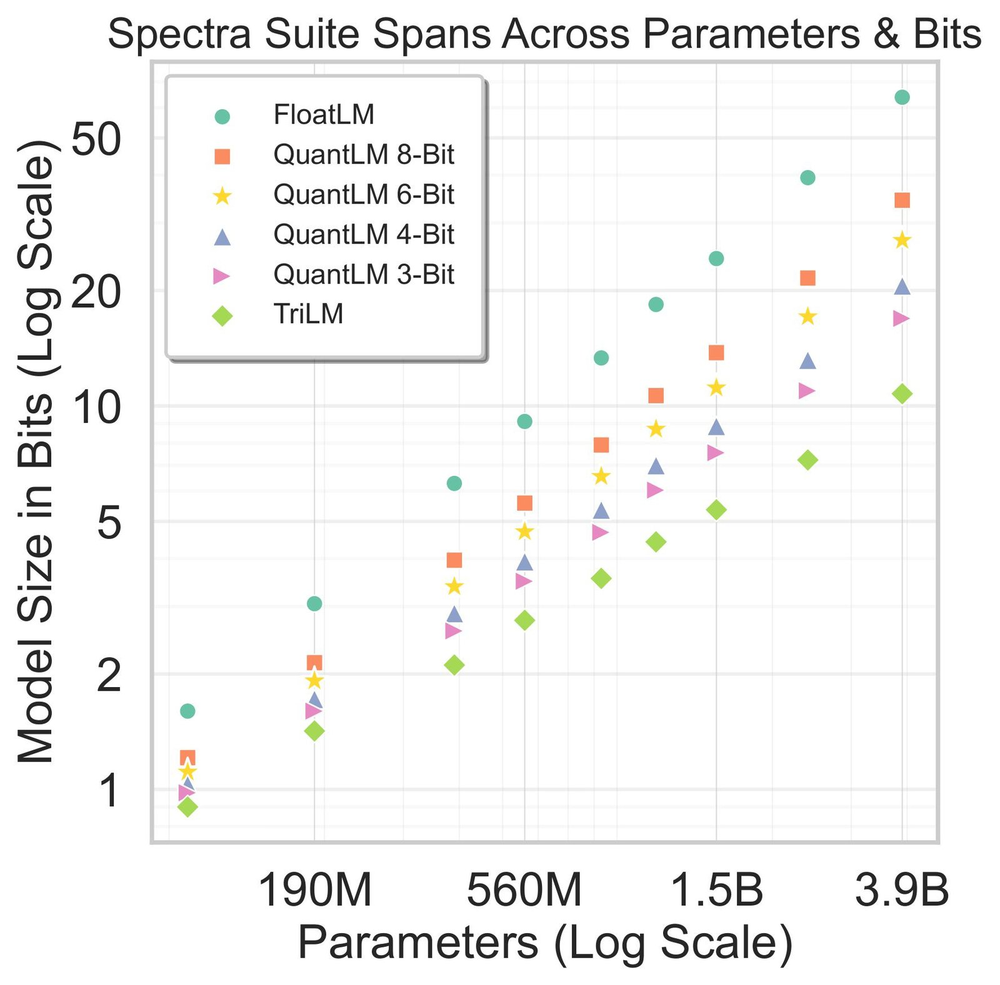
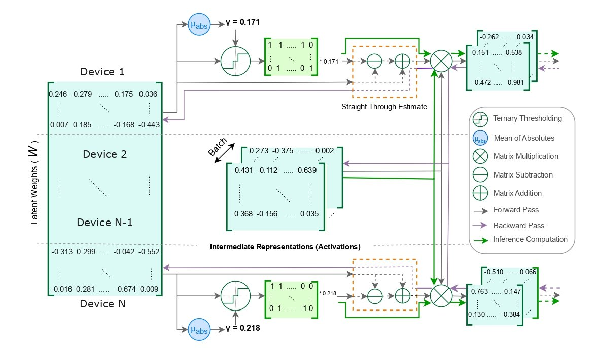
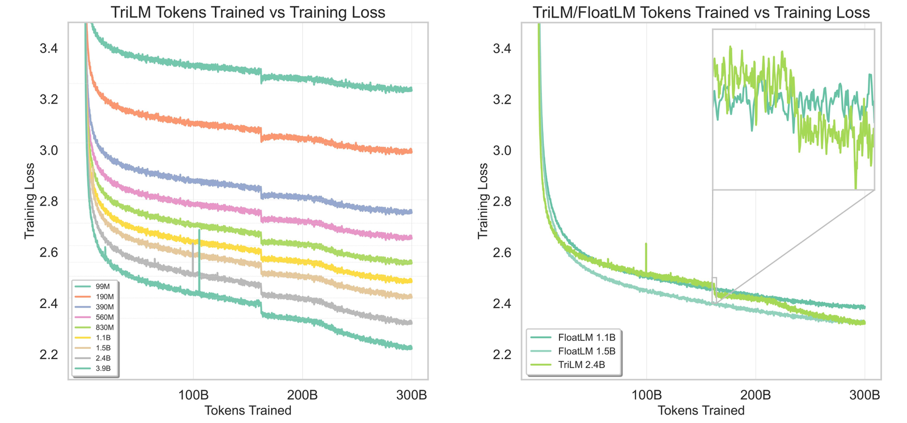
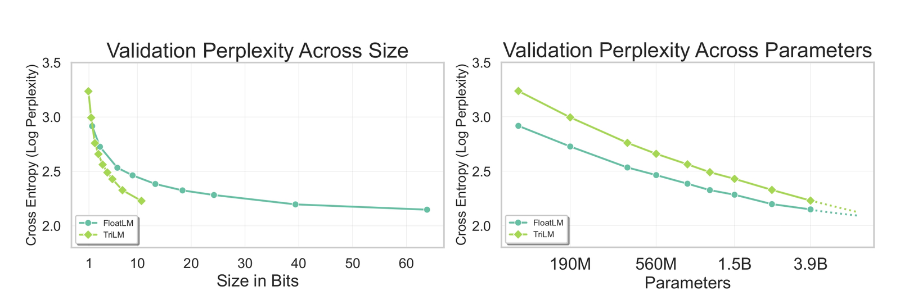
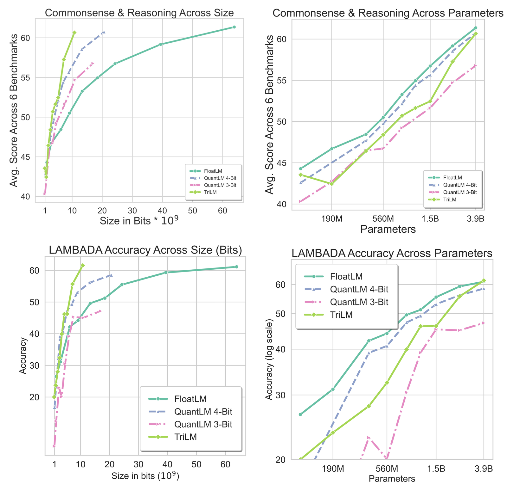
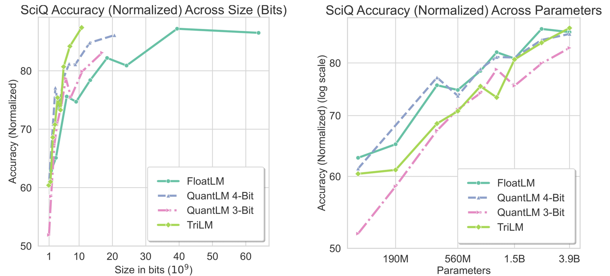
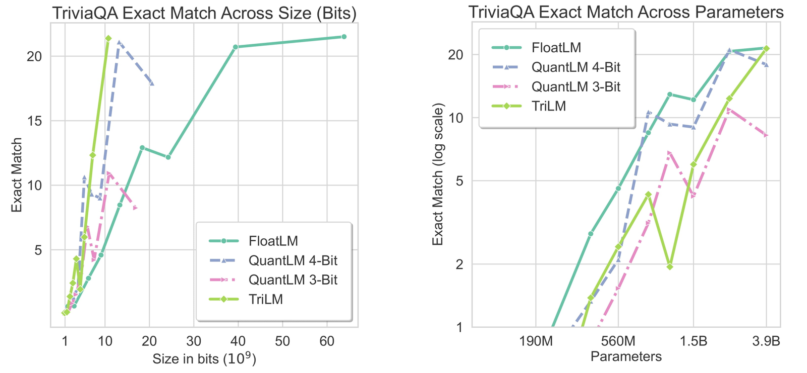
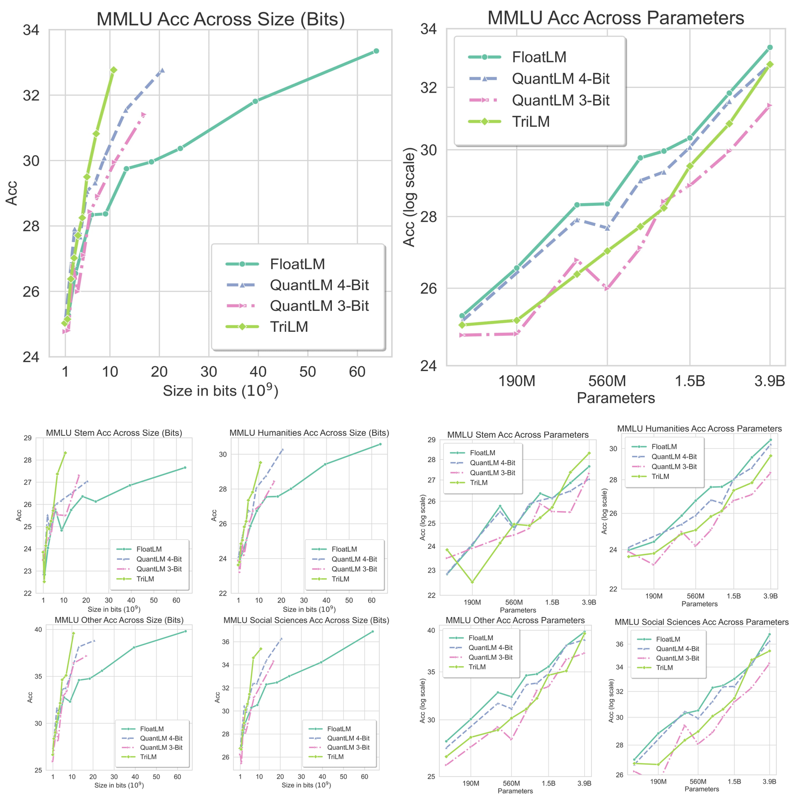

<figure class="banner">
  
</figure>

## Abstract

Post-training quantization is the leading method for addressing memory-related bottlenecks in LLM inference, but it suffers from significant performance degradation below 4-bit precision. An alternative approach is to train compressed models directly at a low bitwidth (for example, binary or ternary models). However, the performance, training dynamics and scaling trends of such models are not yet well understood. To address this, we trained and openly released the **Spectra LLM suite**: 54 language models from 99M to 3.9B parameters, trained on 300B tokens. Spectra includes FloatLMs, post-training quantized QuantLMs (3, 4, 6 and 8 bits), and **ternary LLMs (TriLMs)**, our proposed ternary architecture, which outperforms previously proposed ternary models of a given size (in bits), as well as half-precision and quantized models. For example, TriLM 3.9B is (bit-wise) smaller than the half-precision FloatLM 830M, but matches the half-precision FloatLM 3.9B on commonsense reasoning and knowledge benchmarks. However, TriLM 3.9B is also as toxic and stereotyping as FloatLM 3.9B, a model six times larger in size. TriLM 3.9B also lags behind FloatLM in perplexity on validation splits and web-based corpora, but performs better on less noisy datasets such as LAMBADA and PennTreeBank.

## Overview of the Spectra suite

The Spectra suite contains families of large language models that span different parameter counts and bitwidths: *TriLMs* (ternary language models), *FloatLMs* (FP16 language models) and *QuantLMs* (FloatLMs quantized to 3, 4, 6 and 8 bits). Spectra aims to support scientific research on low-bitwidth LLMs.

The suite has four properties:

- **Scale:** it spans a broad range of parameter counts and bitwidths.
- **Uniform training:** all models are trained on identical data sequences.
- **Public accessibility:** the training data is publicly available for study.
- **Consistent size mapping:** models across the families map one-to-one by size.

Each model family spans 99M to 3.9B parameters, nearly two orders of magnitude. All TriLMs and FloatLMs are trained on the same 300B-token subset of SlimPajama. All QuantLMs are quantized with the same calibration data. Data ordering and batch sizes are kept the same within each model family to support reproducibility and comparison.

<figure>
  
  <figcaption>The Spectra suite spans two dimensions: size (bits) and parameters. Each parameter count has 6 models across bitwidths. Because the FloatLMs are released, the suite can be extended with QuantLMs from other post-training quantization methods.</figcaption>
</figure>

## Architecture of TriLM and FloatLM

TriLM and FloatLM are both LLaMa-style autoregressive transformers, with RMSNorm instead of LayerNorm, a SwiGLU gated MLP instead of the standard transformer MLP, rotary position embeddings (RoPE), multi-headed attention, and no bias terms.

<figure>
  
  <figcaption>Computation flow of the forward and backward pass in a TriLM.</figcaption>
</figure>

In FloatLMs, the weights of linear layers are floating point (FP16/BF16) numbers. In TriLMs, each weight takes one of three states, {-1, 0, 1}, with one floating point scale shared across the matrix. During training, TriLMs keep *latent* (master) weights in floating point, so small updates can accumulate over iterations until they switch the ternary state of a parameter. In the forward pass, the latent weights are ternarized on the fly: the scale is set to the absolute mean of the latent weights, and each parameter is rounded to the nearest ternary state after scaling. In the backward pass, a straight-through estimator passes gradients to the floating point latent weights.

### QuantLM: quantization of FloatLM

We quantize all transformer layer weights. For 3-bit and 4-bit quantization we use a group size of 128, which gives effective rates of 3.25 and 4.25 bits per parameter. We follow recent practice for calibration data and scale it to a million tokens for better reconstruction. More details are in the paper.

To keep the comparison with TriLM fair, some components stay in their original precision: we do not quantize the embedding, the language model head, or activations. We use symmetric quantization throughout. The suite can be extended with other quantization methods.

## Training dynamics and scaling laws

<figure>
  
  <figcaption>Left: training loss of all TriLMs. Right: training loss of a TriLM relative to two smaller FloatLMs.</figcaption>
</figure>

Training loss improves steadily with parameter count. Because all TriLMs were trained on the same data in the same order, small spikes and drops in training loss appear at the same token counts across scales. The two largest models, TriLM 2.4B and TriLM 3.9B, each show one large loss spike in the first half of training. When the peak learning rate is lowered at the halfway point, training loss drops sharply over a few hundred million tokens. For the larger TriLMs (2.4B and 3.9B), the loss then keeps decreasing at its earlier rate; for the smaller ones (1.1B and 1.5B) it plateaus, and for TriLMs under a billion parameters training loss starts to increase. At the two-thirds mark, when weight decay is removed, all models converge faster, most visibly the largest TriLMs.

<figure>
  
  <figcaption>Final validation loss across size (bits) and across parameters.</figcaption>
</figure>

Measured by size, which matters for the token generation phase of inference, TriLMs perform better at the same number of bits as they grow. At the size of TriLM 3.9B, ternary models perform better than models more than five times their size in bits. In our scaling laws up to 3.9B parameters, FloatLMs are better at the same parameter count, but the gap narrows at a billion parameters and above, and the trend suggests TriLMs may match FloatLMs of the same parameter count. Despite this gap in validation loss, TriLMs are competitive with FloatLMs of the same parameter count on commonsense, reasoning and knowledge benchmarks, as shown below.

## Evaluation

### Commonsense and reasoning

<figure>
  
  <figcaption>Commonsense and reasoning results across size (bits) and parameters.</figcaption>
</figure>

We evaluate on eight commonsense and reasoning benchmarks, from logical reasoning questions to grounded and physical commonsense tasks: ARC Easy, ARC Challenge, BoolQ, HellaSwag, WinoGrande, PIQA, LAMBADA and LogiQA, all zero-shot.

The figure shows the average over the first six benchmarks (the same benchmarks reported for BitNet b1.58) across size (bits) and parameters, and LAMBADA separately. At 2.4B and 3.9B parameters, TriLMs perform best for their size on all benchmarks. At 3.9B, TriLM surpasses FloatLM on LAMBADA and is competitive on the six-benchmark average. At the largest scales, TriLMs also outperform 4-bit QuantLMs with the same parameter count.

### Knowledge

Many practical uses of LLMs need knowledge of common subjects such as science, or of topics such as political figures. We evaluate on SciQ and TriviaQA, zero-shot. On both, at 2.4B parameters and above, TriLMs perform best at a given size (bits). Despite having fewer bits, TriLMs show no significant loss of knowledge capacity, unlike what has been [observed for QuantLMs](https://arxiv.org/abs/2404.05405). That low-bitwidth TriLMs have knowledge capacity similar to FloatLMs suggests that knowledge is stored in the presence and sign of a connection (+1 or -1) rather than in its strength.

#### SciQ and TriviaQA

<figure>
  
  <figcaption>SciQ for TriLM, FloatLM, and 3-bit and 4-bit QuantLMs, across size (bits) and parameters.</figcaption>
</figure>

<figure>
  
  <figcaption>TriviaQA for TriLM, FloatLM, and 3-bit and 4-bit QuantLMs, across size (bits) and parameters.</figcaption>
</figure>

#### MMLU

<figure>
  
  <figcaption>MMLU accuracy for TriLM, FloatLM, and 3-bit and 4-bit QuantLMs, across size and parameters.</figcaption>
</figure>

## Conclusion

We introduced the Spectra suite, an open family of LLMs across bitwidths: ternary TriLMs, FP16 FloatLMs, and their quantized QuantLMs (3, 4, 6 and 8 bits), all pretrained on the same 300B tokens. We also presented a simplified TriLM architecture for ternary language modeling that trains stably at FP16 precision. Low-bitwidth models like TriLMs perform better for their size than quantized models at a billion parameters and above. TriLM 3.9B is competitive with FloatLM 3.9B, a much larger model in bits, on commonsense, reasoning and knowledge benchmarks. These results suggest that TriLMs can ease the memory capacity and bandwidth bottlenecks of LLM inference better than QuantLMs.

## Discussion

**Interpretability beyond neurons.** Interpretability work on language models has mostly focused on neuron-level interventions. TriLMs make connection-level interpretability possible: each connection between neurons in a layer is in one of three states, 0 (no connection), -1 (negative) or +1 (positive), all with equal strength. In FloatLMs, connections vary in strength, which makes interpretation harder. We release checkpoints from our training runs to support research in this direction.

**Resource efficiency.** Releasing TriLMs openly means others do not have to pretrain them from scratch. TriLMs need fewer resources to deploy and generate faster, which matters for applications with strict latency requirements and for edge devices such as phones, laptops and cars.

**Specialized hardware.** TriLMs reduce memory use and latency on general-purpose GPUs such as the H100 and RTX 4090. Hardware that supports computations with a high byte-to-FLOP ratio, such as Cerebras, can use the sparsity of ternary weights for speedups in training and inference. Hardware with limited SRAM, such as Groq, can deploy a model on fewer chips because the model is smaller.

**Training costs.** Chinchilla scaling laws suggest that training larger LLMs on fewer tokens is more compute-optimal than training smaller LLMs on more tokens. In practice, the memory and latency cost of deploying larger models pushes training runs well past Chinchilla optimality. Because TriLMs need less memory and have lower latency, they make training runs closer to the Chinchilla parameter-token tradeoff more practical.

## Acknowledgements

We acknowledge support from the Mozilla Responsible AI Grant, the Canada CIFAR AI Chair Program and the Canada Excellence Research Chairs Program. This research used computational resources of the Summit supercomputer, awarded through the Frontier DD allocation and the INCITE 2023 program for the project "Scalable Foundation Models for Transferable Generalist AI", and through the SummitPlus allocation in 2024. These resources were supplied by the Oak Ridge Leadership Computing Facility at the Oak Ridge National Laboratory, with support from the Office of Science of the U.S. Department of Energy. We thank Jens Glaser for his help with the Summit and Frontier supercomputers.

## Citation

BibTeX: [arXiv](https://arxiv.org/bibtex/2407.12327)
