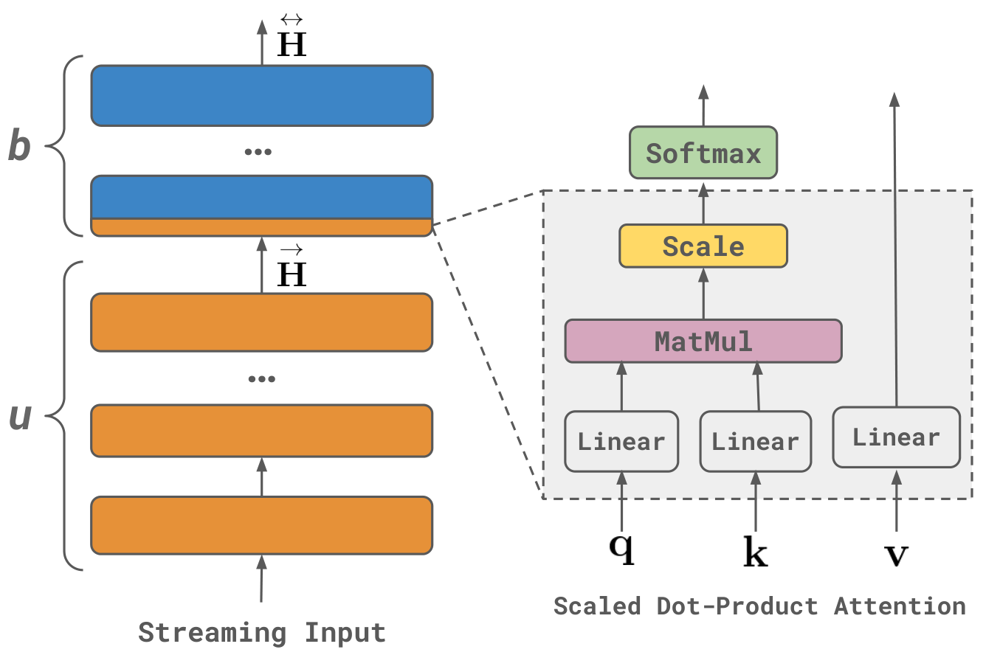
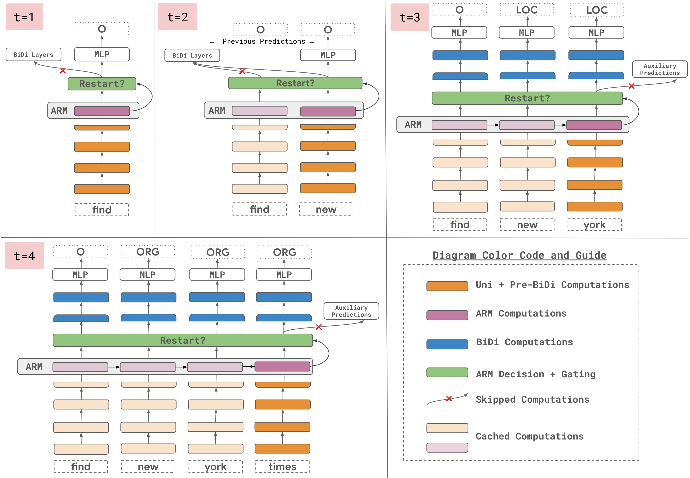
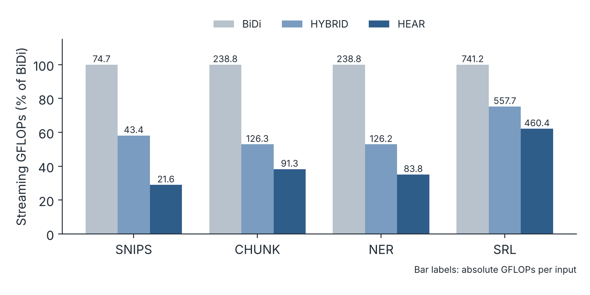
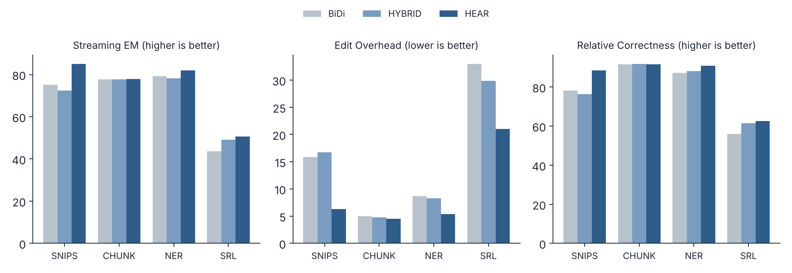
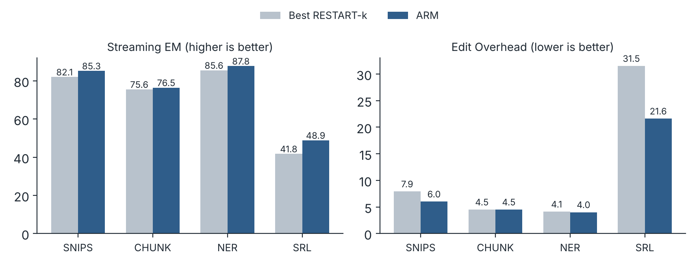
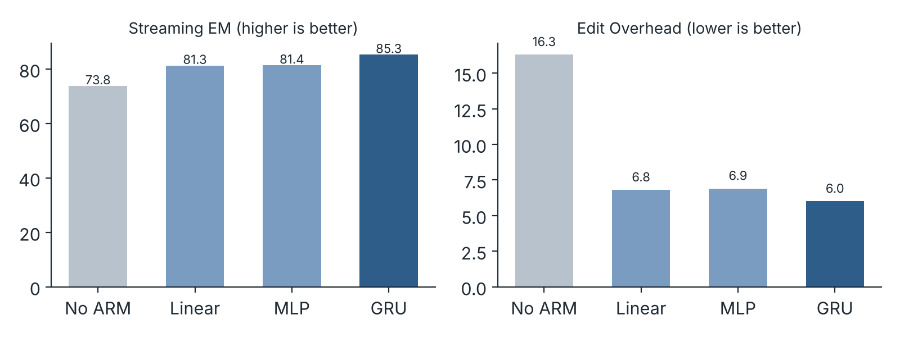

**Ayush Kaushal, Aditya Gupta, Shyam Upadhyay, Manaal Faruqui** · EACL 2023 · Research Internship Project at Google, Mountain View
[Paper](https://aclanthology.org/2023.eacl-main.31/) · [arXiv](https://arxiv.org/abs/2301.09244) · [BibTeX](#citation)

## Summary

- Bidirectional encoders are built for complete inputs. On a stream of tokens, such as transcribed speech, they must re-encode the whole prefix every time a token arrives. For an encoder whose cost is quadratic in input length, that makes the total cost over a stream cubic, and the repeated recomputation also causes labels to flip back and forth.
- We propose **HEAR** (Hybrid Encoder with Adaptive Restarts). Its lower layers are unidirectional and cached, so only the upper bidirectional layers ever need recomputation. A small learned module, the **ARM** (Adaptive Restart Module), decides at each step whether recomputing them is worth it.
- Across four sequence tagging tasks, HEAR reduces streaming compute by 58.9% on average relative to a bidirectional encoder (up to 71.1%), keeps offline accuracy, and improves streaming exact match by up to 10.0 points.

| Model (SNIPS test set) | Streaming GFLOPs | Offline F1 | Streaming EM |
|---|---|---|---|
| Bidirectional encoder | 74.7 | 93.1 | 75.1 |
| HYBRID encoder | 43.4 | 93.0 | 72.5 |
| HEAR (HYBRID + ARM) | 21.6 | 93.0 | 85.1 |

*Table 1 of the paper.*

## The problem: encoders built for complete inputs

Standard text encoders assume the offline setting: the full input is available before encoding starts. Many applications instead receive input incrementally, such as a spoken request transcribed word by word or a query being typed. Processing such input as it arrives can enable suggestions on partial inputs, reduce latency once the input ends and make language interfaces more interactive.

Applied naively to a stream, a bidirectional encoder such as BERT has two problems:

1. **Cost.** When a new token arrives, every layer must be recomputed for every token, because each token's representation depends on the tokens to its right. An encoder that costs O(n²) on one input of length n therefore costs O(n³) over the n prefixes of a stream.
2. **Partial inputs.** The encoder is trained only on complete inputs, so it generalizes poorly to prefixes, and its predictions for earlier tokens keep changing as new tokens arrive.

A unidirectional encoder avoids both problems, because a token's representation never changes once computed, but it is clearly less accurate on complete inputs. An earlier family of approaches waits for k future tokens before labelling a word. This adds a fixed output lag and struggles with tasks that need long-range context, such as semantic role labelling (SRL).

## The task and how we measure it

At step t, the model has received the first t tokens and predicts a tag for each of them. Training data contains only labels for complete inputs, even though the correct label of an early token can depend on tokens that have not arrived yet.

We evaluate three things:

- **Offline quality:** chunk-level F1 on the complete input.
- **Streaming compute:** total GFLOPs to process every prefix of an input, measured through the XLA compiler's high-level operations.
- **Streaming quality:** three metrics over the sequence of prefix predictions:
  - **Edit Overhead (EO)** is the fraction of label edits that were unnecessary relative to the final prediction. Lower is better.
  - **Relative Correctness (RC)** is the fraction of prefix predictions that agree with the model's own final prediction. Higher is better.
  - **Streaming Exact Match (EM)** is the fraction of prefix predictions that agree with the ground truth. Higher is better.

EO and RC alone are not enough. A unidirectional encoder never revises a label, so it scores perfectly on both while still being wrong against the ground truth. Streaming EM measures accuracy, not just stability.

Here is how the three metrics work on the input "find new york times square", whose ground truth tags the last four words as one location:

| Step | Token | Prefix prediction | Total edits | Unnecessary edits | Matches ground truth | Matches final prediction |
|---|---|---|---|---|---|---|
| 1 | find | O | 1 | 0 | yes | yes |
| 2 | new | O O | 2 | 1 | no | no |
| 3 | york | O LOC LOC | 4 | 3 | yes | no |
| 4 | times | O ORG ORG ORG | 7 | 3 | no | yes |
| 5 | square | O ORG ORG ORG LOC | 8 | 3 | no | yes |

*Adapted from Table 3 of the paper. Ground truth: O LOC LOC LOC LOC.*

Three of the eight edits were unnecessary, so EO = 3/8. Three of the five prefix predictions agree with the final prediction, so RC = 3/5. Two agree with the ground truth, so Streaming EM = 2/5.

## HYBRID encoder: cache the bottom, recompute the top


*Figure 1 of the paper. The first u layers are unidirectional and the last b layers are bidirectional. Orange computation can be cached across steps; blue layers must be recomputed (restarted) when a new token arrives. Kaushal et al. (2023), CC BY 4.0.*

The HYBRID encoder splits a fixed layer budget l into u unidirectional layers followed by b bidirectional layers, with u + b = l. The unidirectional layers can be any causal layer, such as a GRU or a causally masked transformer layer.

In streaming mode, the unidirectional layers run only on the new token and reuse cached state for the old ones: hidden states for a recurrent layer, keys and values for a causal transformer. Part of the first bidirectional layer can be cached too, since the new token's query and key do not depend on future tokens. Only the remaining bidirectional computation must be redone over the whole prefix.

The encoder has two prediction heads, both trained on complete inputs:

- the main head on the bidirectional output, and
- an **auxiliary head** on the unidirectional output, which gives a cheap label for the newest token without any recomputation.

Gradients from the auxiliary head are blocked from flowing into the shared layers. This choice matters: training both heads jointly lowered the bidirectional head's development F1 on CoNLL from 81.20 to 71.62, and reweighting the two losses recovered it only to 75.06.

## Adaptive restarts: learning when recomputation pays

Even with the cheaper HYBRID encoder, restarting the bidirectional layers at every step is often unnecessary. At each step t, HEAR makes a binary decision RESTART(t):

- **Restart:** recompute the bidirectional layers and relabel every token in the prefix.
- **Wait:** label the new token with the auxiliary head and copy all earlier labels from the previous step.

The model always restarts at the final step, so offline accuracy is unchanged.


*Figure 2 of the paper. At t = 1 and t = 2, the ARM chooses to wait and labels the new token from the unidirectional encoding. At t = 3 and t = 4, it restarts the bidirectional layers. The unidirectional layers and the ARM only ever process the newest token. Kaushal et al. (2023), CC BY 4.0.*

A simple baseline, **RESTART-k**, restarts every k steps. The **ARM** instead learns the decision:

- **Inputs:** only features that need no recomputation. These are the newest token's unidirectional encoding, its query and key in the first bidirectional layer, and the unnormalized attention scores between earlier tokens' queries and the new key, over the most recent m tokens and all heads.
- **Model:** a single-layer GRU that outputs a restart probability.
- **Training target:** at each step, restart if the bidirectional predictions on the prefix match the ground truth on more tokens than the wait-and-copy predictions do. This target is greedy; an optimal policy would require knowing future tokens.
- **Post-processing:** minimum and maximum waiting times, tuned on development data, prevent restarts that are too frequent or too rare.

## Setup

We use four sequence tagging tasks: slot filling on SNIPS, SRL on OntoNotes, and named entity recognition (NER) and chunking (CHUNK) on CoNLL-2003. All models have a budget of 4 encoder layers (512-dimensional, 8 heads, 2048-dimensional feed-forward), with embeddings initialized from 300-dimensional GloVe vectors.

The number of unidirectional layers in HEAR is chosen per task by development-set offline F1. The RESTART-k baseline uses the best k in {2, 3, 5, 8} by development-set streaming EM. Test results are averaged over four seeds.

## Result 1: HYBRID keeps offline accuracy and removes about 40% of streaming compute

On complete inputs, the HYBRID encoder matches the bidirectional encoder: 93.0 against 93.1 F1 on SNIPS, 80.1 against 80.0 on SRL, and 0.8 F1 higher on NER. A fully unidirectional encoder is clearly worse on every task.

In streaming, HYBRID reduces compute by 41.9% on SNIPS, 47.1% on CHUNK, 47.2% on NER and 24.8% on SRL relative to the bidirectional encoder, 40.2% on average. It does not, however, improve streaming quality. On SNIPS its streaming EM is lower than the bidirectional encoder's (72.5 against 75.1), because it still restarts at every step.

## Result 2: HEAR reduces compute further and improves streaming quality


*Streaming compute as a percentage of the bidirectional encoder, with absolute GFLOPs per input on each bar. Redrawn from Table 5 of the paper.*

Adding the ARM reduces compute below HYBRID on every task. Relative to the bidirectional encoder, HEAR uses 71.1% fewer FLOPs on SNIPS, 61.8% on CHUNK, 64.9% on NER and 37.9% on SRL, 58.9% on average. SRL shows the smallest saving. This is consistent with SRL also having the weakest unidirectional predictions (42.8 development F1, against 79.7 for the bidirectional head), which leaves fewer steps where waiting is safe.


*Streaming quality on the test sets. Redrawn from Table 5 of the paper.*

HEAR also gives better streaming predictions than restarting at every step:

- **Streaming EM** improves over the bidirectional encoder by 10.0 points on SNIPS, 7.0 on SRL and 2.6 on NER.
- **Unnecessary edits** fall by up to 12.0 points of EO, on SRL.

The gains depend on the task. On CHUNK the difference is negligible: streaming EM rises by 0.2 points, and RC is identical at 91.6.

The improvement in quality is not only a by-product of saving compute. Restarting at every step lets the encoder revise early labels on incomplete evidence, which produces the unnecessary label flips seen in the bidirectional and HYBRID columns. Waiting until a restart is likely to help avoids many of those revisions.

## Ablations

**Unidirectional predictions are useful but not sufficient.** On the development sets, the auxiliary unidirectional head reaches 79.1 F1 on SNIPS, 86.8 on CHUNK, 77.9 on NER and 42.8 on SRL, against 93.6, 90.4, 91.3 and 79.7 for the bidirectional head. They are good enough to label the newest token between restarts, except on SRL.


*ARM against the best RESTART-k on the development sets. Redrawn from Table 6 of the paper.*

**A learned restart policy beats a fixed interval.** The ARM improves streaming EM over the best RESTART-k on all four tasks, most on SRL (41.8 to 48.9). On edit overhead, the gain is large on SRL (31.5 to 21.6) and SNIPS (7.9 to 6.0), but negligible on NER (4.1 to 4.0) and absent on CHUNK (4.5 for both). As a binary classifier against its training target, the ARM reaches between 67.1 (CHUNK) and 80.2 (SRL) micro-F1, so there is room to improve it.


*HEAR with different ARM architectures on the SNIPS development set. Redrawn from Table 7 of the paper.*

**The ARM benefits from recurrence.** On SNIPS, any learned restart policy is far better than restarting at every step (streaming EM 73.8, EO 16.3). A linear layer or an MLP reaches about 81 streaming EM. A GRU, which carries state from one step to the next, reaches 85.3 streaming EM and 6.0 EO.

## Takeaway

Streaming inputs separate the computation that depends only on the past, which can be cached, from the computation that depends on the future, which must be redone. HEAR makes that split explicit in the architecture, then learns when the second kind of computation is worth paying for. Learning that decision saves compute and, on most tasks, also produces more stable and more accurate predictions on incomplete input.

## Citation

```bibtex
@inproceedings{kaushal-etal-2023-efficient,
    title = "Efficient Encoders for Streaming Sequence Tagging",
    author = "Kaushal, Ayush  and
      Gupta, Aditya  and
      Upadhyay, Shyam  and
      Faruqui, Manaal",
    editor = "Vlachos, Andreas  and
      Augenstein, Isabelle",
    booktitle = "Proceedings of the 17th Conference of the {E}uropean Chapter of the {A}ssociation for {C}omputational {L}inguistics",
    month = may,
    year = "2023",
    address = "Dubrovnik, Croatia",
    publisher = "Association for Computational Linguistics",
    url = "https://aclanthology.org/2023.eacl-main.31/",
    doi = "10.18653/v1/2023.eacl-main.31",
    pages = "418--429"
}
```
