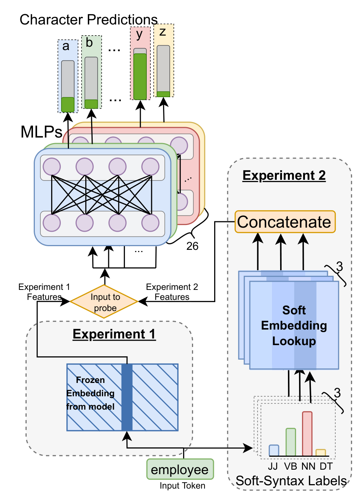
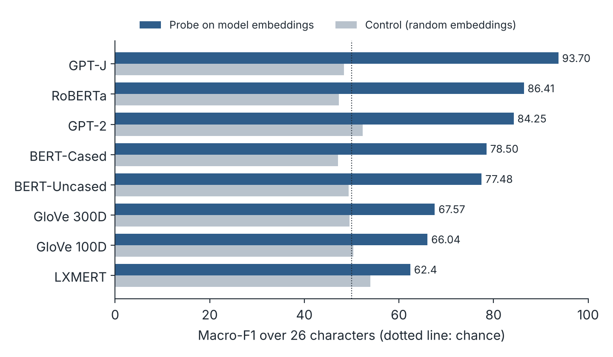
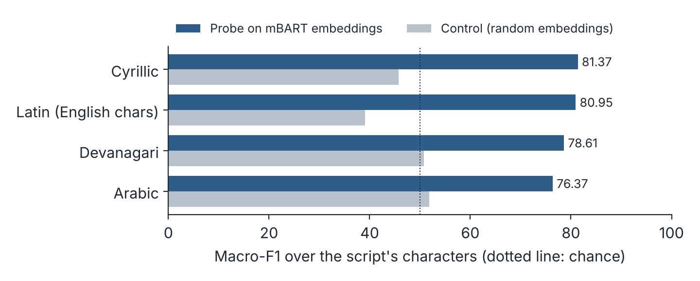
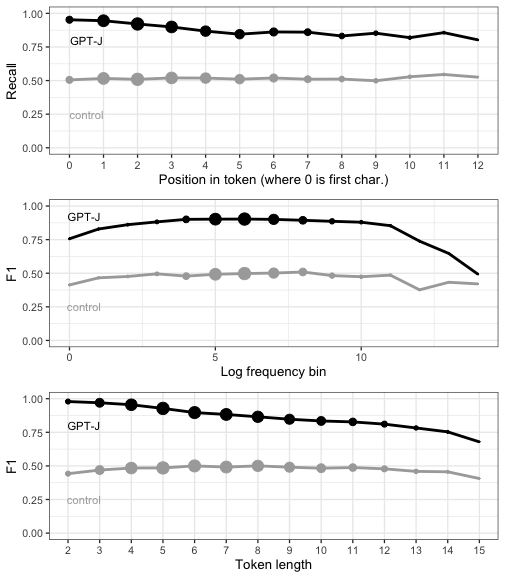
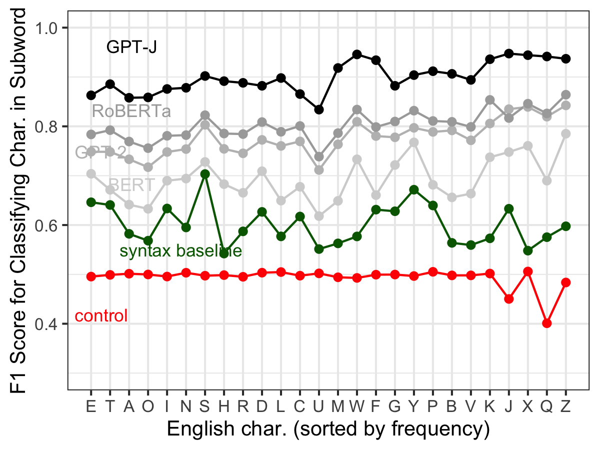
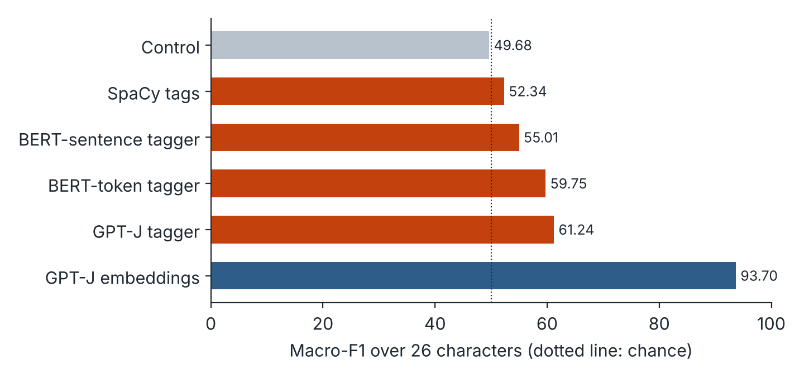
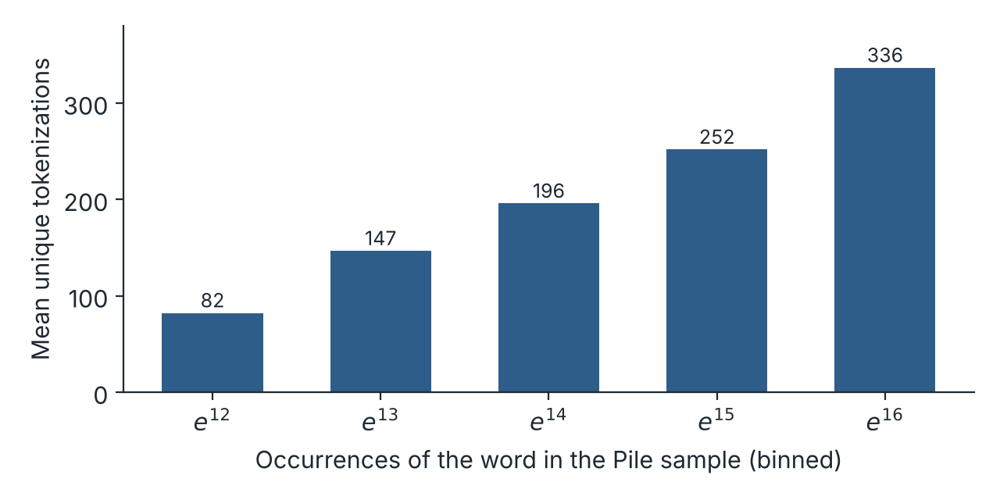
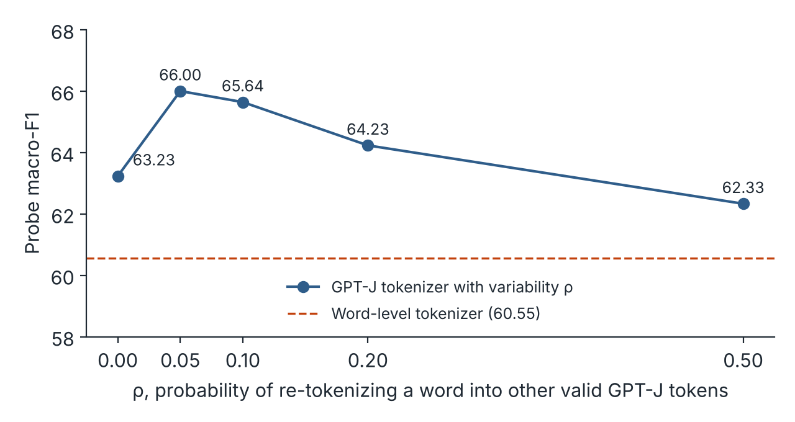

**Ayush Kaushal, Kyle Mahowald** · NAACL 2022 · The University of Texas at Austin
[Paper](https://aclanthology.org/2022.naacl-main.179/) · [arXiv](https://arxiv.org/abs/2206.02608) · [Code](https://github.com/ayushk4/character-probing-pytorch) · [Talk](https://aclanthology.org/2022.naacl-main.179.mp4) · [BibTeX](#citation)

## Summary

- The static input embeddings of subword language models encode which characters a token contains. A per-character probe on GPT-J embeddings reaches 93.70 macro-F1, against 48.36 for a control with random embeddings and the same probe.
- The result holds across alphabetic scripts. On Multilingual BART, probes reach between 76.37 (Arabic) and 81.37 (Cyrillic) F1.
- We identify two mechanisms that contribute: systematic correlations between characters and parts of speech, and the variability with which the same word is split into tokens. Neither alone accounts for the full effect.

## The question

Most large language models do not read characters. Tokenizers such as BPE and WordPiece split text into subword units, and each unit enters the model as a single embedding vector. Nothing in the input tells the model that the token `cat` is made of `c`, `a` and `t`.

Yet these models can solve tasks that depend on spelling. Earlier work showed T5 exploiting character-level information to solve cryptic-crossword wordplay such as unscrambling words, and RoBERTa mapping a word to its characters in a spelling task. This raises two questions:

1. **What** do token embeddings encode about the characters they contain?
2. **How** does that information get there, when the pretraining objective never asks for it?

## Measuring character knowledge with probes


*Figure 1 of the paper. In Experiment 1, the probe input is a token's frozen model embedding. In Experiment 2, the input is syntactic features of the token instead. Kaushal and Mahowald (2022), CC BY 4.0.*

For each letter of the alphabet, we train a separate binary classifier, a small MLP, that takes a token's embedding and predicts whether the token contains that letter. For example, the `a` probe should say yes for `cat` and no for `cool`.

We probe the static, non-contextual input embeddings of GPT-J, GPT-2, RoBERTa, BERT (cased and uncased), GloVe and the language embeddings of LXMERT. For English, we keep only vocabulary tokens made of the letters a to z, plus the markers these tokenizers use for a preceding space or a word continuation.

Three design choices make the comparison meaningful:

- **Balanced data.** For each letter, we undersample negatives so that half the examples contain the letter. Chance is therefore 50 F1, even for a rare letter such as `z`.
- **Lemma-disjoint splits.** Tokens that share a lemma, such as `run` and `running`, always land in the same train or test split. The probe cannot succeed by recognizing a word form it saw during training.
- **A matched control.** The control replaces the trained embeddings with random frozen embeddings and trains the same probe. A model scores well only if its embeddings carry information that the probe's own capacity cannot supply.

Scores are macro-F1 averaged over the 26 letters and over 5 train-test splits with different seeds.

## Result 1: subword embeddings encode their characters


*Character probing results by model. Redrawn from Table 1 of the paper.*

Every model is well above its control, and the controls sit near chance. GPT-J, the largest model, is best at 93.70 F1. RoBERTa (86.41) and GPT-2 (84.25) follow, then the BERT models (78.50 and 77.48). All of these outperform the fixed GloVe embeddings (67.57 and 66.04), while the language embeddings of the multimodal LXMERT score lowest (62.4). Performance broadly tracks model scale and pretraining data, in line with how these models rank on other language tasks.

The tokenizer also appears to matter. RoBERTa outperforms BERT at a similar size, and RoBERTa uses a byte-level BPE based on GPT-2's, which tokenizes the same word differently depending on whether a space precedes it. We return to this kind of variability below.

The embeddings also support a harder task. Given two GPT-J tokens, a probe on their concatenated embeddings decides whether one is a substring of the other (is `ome` inside `some`?) with 86.56 F1, against 70.03 for the control. The control is above 50 here because some substrings, such as `en`, are more common than others, and the probe can learn those base rates without any embedding information.

## Result 2: the effect holds across scripts


*Multilingual BART probing results by script. Redrawn from Table 2 of the paper.*

To test whether this is an artifact of English, we probe Multilingual BART on tokens written entirely in one script, for each character that appears in at least 250 tokens. Performance is consistently far above the controls: 81.37 F1 for Cyrillic, 80.95 for Latin, 78.61 for Devanagari and 76.37 for Arabic. Because lemmas are hard to define across mBART's mixed-language vocabulary, these splits are not lemma-disjoint, so they are a somewhat easier setting than the English experiments.

## What makes a character easy to recover


*Figure 3 of the paper. GPT-J probe performance relative to the control, by the character's position in the token (top), the token's log frequency (middle) and the token's length (bottom). Kaushal and Mahowald (2022), CC BY 4.0.*

We break down the GPT-J results along four dimensions:

- **Position.** If the model learned spelling mainly from alphabetized word lists, the first letter should stand out. Recall does fall with position, but only slightly (β = −0.01, p < .001). The first letter is recalled at 95.2 and the second at 94.5, and the probe stays above chance for letters 10 or more characters deep.
- **Frequency.** If character knowledge came from frequent tokens occasionally appearing spelled out, frequent tokens should be easier. They are not. If anything, less frequent tokens are slightly easier (β = −0.013, p = .05).
- **Length.** Characters are easier to detect in short tokens. A short token such as `be` has fewer characters to represent.
- **Character identity.** Rare letters are easiest: J, W, X, Q and Z all exceed 93 F1. Vowels are hardest: U, A, O and E fall between 83 and 86, still far above chance.


*Figure 2 of the paper. Average F1 by character for selected models. The control is in red and the syntax baseline in green; GPT-J is the darkest line. Kaushal and Mahowald (2022), CC BY 4.0.*

## How does the information get there? Mechanism 1: morphosyntax

The relationship between a word's form and its meaning is largely arbitrary, which is why it is surprising that embeddings learned from co-occurrence encode spelling at all. But the arbitrariness is not complete. Morphology ties certain letters to grammatical categories: roughly 12% of American English words contain `y`, but 85% of adverbs do. A model that knows a token is an adverb can guess that it contains `y` and be right most of the time.

The probe's most confident predictions fit this account. The tokens it rates most likely to contain `y` are `lly`, ` selectively`, ` subtly` and ` mechanically`, all adverb endings. Its most confident `s` predictions, ` socialists`, ` stocks` and ` suggestions`, all end in a plural or verbal `-s`.

To measure how far syntax alone goes, Experiment 2 replaces the model embedding with syntactic features of the token and runs the same probe. We use two kinds of features:

- **SpaCy tags:** fine-grained part of speech, coarse part of speech and named-entity type, as one-hot vectors. SpaCy tags words rather than subword tokens.
- **Subword taggers:** small models trained on CoNLL-2003 that tag subword tokens directly and output a probability distribution over part-of-speech and entity labels. The best of these, the GPT-J tagger, takes GPT-J's static embedding as its input.


*Character probing from syntactic features alone, against the probe on full GPT-J embeddings. Redrawn from Tables 1 and 14 of the paper.*

Syntactic features carry real character information: every syntax probe beats the control (49.68), and the GPT-J tagger reaches 61.24. As predicted, the gains concentrate on morphologically informative letters, `s` (66.82 against 40.32 for the control) and `y` (64.89 against 48.68). But the best syntax probe remains far below the 93.70 obtained from the embeddings themselves, and GPT-J's per-character profile in Figure 2 shows only a slight rise on `s`, unlike the sharp peak of the syntax baseline. Syntax explains part of the effect, not most of it.

## Mechanism 2: tokenization variability

A subword tokenizer does not split a word the same way every time. Its segmentation depends on capitalization, on a preceding space and on spelling. Here are some GPT tokenizations of `dictionary` and related forms:

<table>
  <thead>
    <tr><th>String</th><th>Tokenization</th></tr>
  </thead>
  <tbody>
    <tr><td><code>"dictionary"</code></td><td><code>d + ictionary</code></td></tr>
    <tr><td><code>" dictionary"</code></td><td><code> dictionary</code></td></tr>
    <tr><td><code>"dictionaries"</code></td><td><code>d + iction + aries</code></td></tr>
    <tr><td><code>" dictionaries"</code></td><td><code> diction + aries</code></td></tr>
    <tr><td><code>"dicionary"</code> (misspelled)</td><td><code>d + icion + ary</code></td></tr>
  </tbody>
</table>

*Table 4 of the paper.*

These five forms alone produce 8 distinct tokens. Some pairs share no token at all, yet they denote the same word. A model gains from relating them, and learning which characters each token contains is a general way to do so: it lets the model connect `dictionary` to `diction + aries`, and even interpret a split it has never seen.

Case and spacing alone already produce many variants. For `signature`:

| String | GPT-J tokenization |
|---|---|
| `"signature"` | `sign + ature` |
| `"SIGNATURE"` | `SIGN + ATURE` |
| `"SigNature"` | `S + ig + Nature` |
| `" signature"` | `Ġsignature` |
| `" signaTure"` | `Ġsign + a + T + ure` |
| `" signatre"` (misspelled) | `Ġsign + atre` |

*Selected rows from Table 18 of the paper. `Ġ` marks a preceding space.*

**How common is this?** We measured it on one-sixth of the Pile (about 250 GB of text), the corpus GPT-J was trained on. We took frequent words of 8 or more characters and found every occurrence within one edit of each word, excluding matches that were closer to a different English word. Across the 466 resulting words, the average word appears with 213.74 distinct tokenizations. Exact case variants without a preceding space account for about 6 of them, and adding whitespace variants raises this to about 18. The rest come from misspellings and other variants. Frequent words show more tokenizations, because they have more occasions to vary.


*Mean number of unique tokenizations per word, binned by how often the word occurs in the Pile sample. Redrawn from Table 16 of the paper ("Matches closer pseudo" column).*

**Testing the mechanism.** If variability drives character learning, then increasing variability should increase character knowledge. Training transformers from scratch under different tokenizers was out of scope, so we ran a proof of concept with CBOW word embeddings on a 1.1B-character portion of the Pile. We trained one model per tokenization scheme:

- **Word-level** tokenization, the CBOW default.
- **Standard GPT-J** subword tokenization.
- **GPT-J with variability ρ.** With probability ρ, each word is re-split into an alternative pair of valid GPT-J tokens. For example, ` schematics` is normally ` sche + mat + ics`, but may become ` schema + tics` or ` schematic + s`. ` schemati + cs` is never produced, because ` schemati` is not a GPT-J token.


*Probe F1 on CBOW embeddings as tokenization variability ρ increases. The y-axis starts at 58 to make the differences visible. Redrawn from Table 5 of the paper.*

Subword tokenization yields more character information than word-level tokenization (63.23 against 60.55). Adding a little variability increases it further, peaking at 66.00 at ρ = 0.05. Beyond that, performance declines, to 62.33 at ρ = 0.5. A likely explanation for the decline is the small corpus: with high variability, each token is seen fewer times. The differences are small, but they were consistent across seeds and splits. This is evidence that variability affects character learning in CBOW. Whether the same holds for pretrained transformers remains to be tested, though the result is in line with earlier work on subword regularization such as BPE-dropout.

## Takeaways

Spelling is a property of language that is almost unrelated to meaning: nothing about a dog requires the word to be spelled `d-o-g`. Even so, subword models trained only to predict words acquire it, and they encode it robustly across models, character positions, token frequencies and scripts. At least two routes contribute: correlations between letters and grammatical categories, and the variability with which tokenizers split the same word.

The second route is something model designers can control. Tokenization schemes with some controlled variability could be one way to give models richer character-level knowledge, which matters for tasks such as wordplay, misspelling-heavy text and multilingual settings where tokenization is especially uneven.

## Citation

```bibtex
@inproceedings{kaushal-mahowald-2022-tokens,
    title = "What do tokens know about their characters and how do they know it?",
    author = "Kaushal, Ayush and Mahowald, Kyle",
    booktitle = "Proceedings of the 2022 Conference of the North American Chapter of the Association for Computational Linguistics: Human Language Technologies",
    month = jul,
    year = "2022",
    address = "Seattle, United States",
    publisher = "Association for Computational Linguistics",
    url = "https://aclanthology.org/2022.naacl-main.179/",
    doi = "10.18653/v1/2022.naacl-main.179",
    pages = "2487--2507"
}
```

*This work was supported by NSF Grant No. 2104995 to Kyle Mahowald.*
